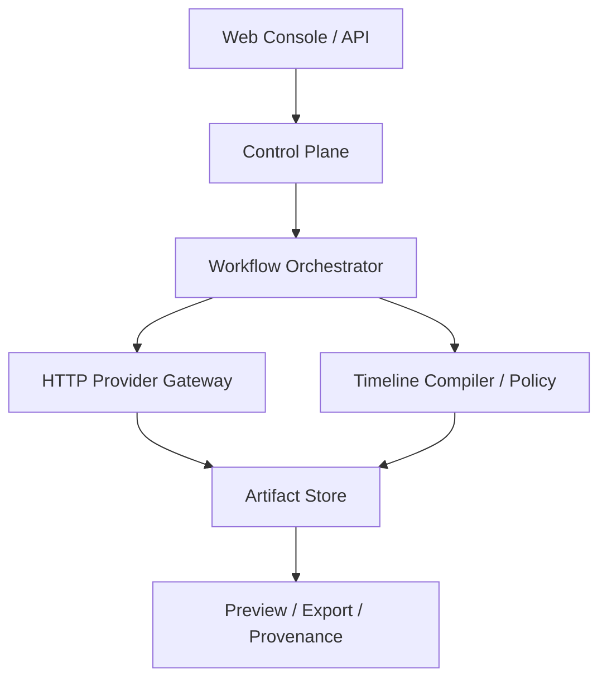

# Video AI Studio 第一阶段架构

## 原则

1. 原始素材不可变，所有派生物通过 `parent_asset_id` 和 hash 关联。
2. Timeline 是项目真源，AI 生成结果只是 Artifact；所有 AI 操作记录为可审阅的 Operation。
3. 控制面不执行 GPU 推理、媒体分析或转码；生产通过已存在的 Hosted AI API 完成计算，Worker 只负责编排、轮询、回调和审计。
4. Draft、Review、Final 分离；Final 渲染必须携带 Render Manifest 和质量门禁结果。
5. 租户、授权、许可证、模型版本和 C2PA provenance 从第一版数据模型开始保留。

## 分层

## P0 工作流

`project.create -> asset.upload -> asset.analyze -> timeline.create -> timeline.validate -> render.draft -> quality.check -> review -> render.final`

开发环境可使用 SQLite 和文件存储验证控制面；生产素材与成品应放在对象存储，Provider 通过 HTTPS/S3 等远端 URI 读写。生产 Worker 不下载媒体、不调用 FFmpeg/ffprobe，切换 PostgreSQL 与对象存储不改变 Job/Artifact API。

## 模型注册

生产模型必须登记代码许可证、权重许可证、第三方依赖、版本、checksum、显存需求、地区限制、商用状态和质量基准。代码仓库的 MIT/Apache 许可不能推导出模型权重可商用。
