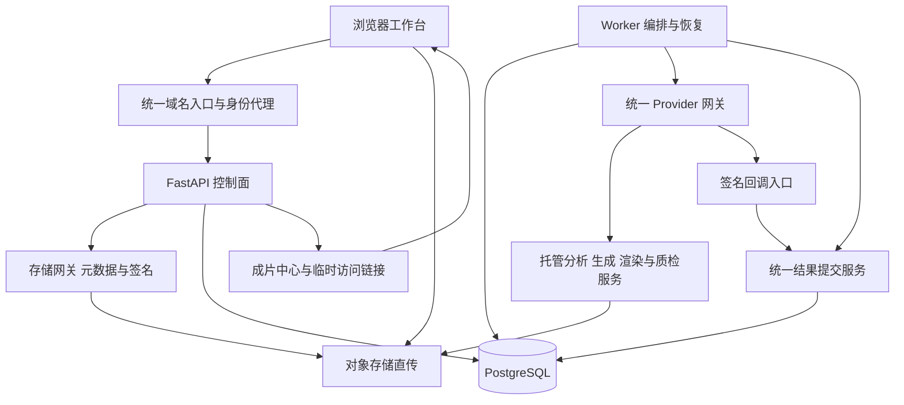

# Video AI Studio 详细设计与交付方案

本方案面向产品、前端、后端和测试开发，明确各模块的实现方法、目标效果、用户看到的形式和验收条件。产品定位为使用外部托管媒体 API 的视频生产工作台，首先交付“上传素材、选择模板、审阅剪辑、预览、导出”的完整链路，再逐项开放生成、声音与数字人能力。

基线为当前 `cd959be` 版本。下文的“已有”表示仓库存在相应实现，不代表真实供应商或生产环境验收通过；“新增”和“补齐”均属于待实现设计。所有数值指标均为建议验收目标，正式承诺须以固定样本测试和所选供应商合同为依据。

最新产品范围见[自动剪辑与微信小程序综合产品方案](integrated-product-design.md)：小程序为个人独立工作台，具备网页全部用户功能；两端按场景简化交互，覆盖商家、个人创作者和代运营批量用户。本文的模块能力同时适用于两端，页面举例不是终端功能限制。

## 产品范围与交付原则

首个可交付版本服务短视频制作：用户导入若干素材，选择画幅、目标时长和风格，得到可调整的剪辑方案及可播放、可下载的成片。初始验收场景采用 3 至 10 段素材制作 15 至 60 秒视频；这是控制首轮验收范围，不是已有系统限制。

生产环境继续保持 `PROVIDER_MODE=api_only`、`ASSET_STORAGE_MODE=external`。应用进程处理元数据、策略、编排和账务；媒体分析、缩略图、音频波形、渲染、转码及媒体质量检测均委托外部服务。用户浏览器直接上传对象存储。

产品默认先显示已经验收的能力。尚未接通的扩展能力在管理端显示“待配置”或“待验收”，普通用户无法创建必然失败的任务。模板展示、接口存在、静态检查通过、真实能力验收是四个不同状态。

第一版不以完整专业剪辑器为目标。优先提供镜头替换、排序、裁切、字幕修订和音量调整；复杂关键帧、调色曲线、多机位编辑和插件体系另立后续范围。

## 总体架构与责任边界

| 组件 | 责任 | 明确边界 | 最终运行形式 |
| --- | --- | --- | --- |
| Web 工作台 | 编辑参数、上传、审阅、展示任务与媒体 | 不持有供应商密钥，不作为租户身份权威 | 同域名静态网页 |
| 身份代理 | 验证登录会话、映射成员及租户、签发内部身份头 | 剥离外部同名身份头 | 入口服务或已有企业网关 |
| API | 权限、业务校验、创建任务、查询与发布 | 不代理媒体字节 | FastAPI 服务 |
| Worker | Claim、提交、轮询、恢复、调用完成事务 | 不运行本地媒体推理和 FFmpeg | 独立进程，可增加副本 |
| Provider 网关 | 厂商字段映射、远端任务映射、结果归一化 | 每种能力必须有真实适配及验收证据 | 独立托管网关或供应商兼容服务 |
| 存储网关 | 签发上传与下载链接，检查实际对象，签发完成证明 | 使用租户对象前缀和存储凭据 | 独立服务或已有存储后端 |
| PostgreSQL | 业务数据、任务、事件、版本与账务 | 不存大媒体文件 | 生产数据库 |
| 对象存储 | 原始素材、派生媒体、报告、来源清单 | 默认私有，不依赖永久公开 URL | 外部托管存储 |

新增网关是明确的交付工作，不能用一份示例配置代替。优先沿用数据库任务队列，达到并发和调度瓶颈后再评估 Temporal；已有 Temporal 适配层不等于已经部署完整工作流集群。

## 工作台最终结构

| 页面 | 主要内容 | 用户动作 | 空态和失败呈现 |
| --- | --- | --- | --- |
| 项目首页 | 项目卡片、实际任务统计、最近成片 | 新建、搜索、进入、归档 | 无数据时显示引导，不保留示例运营数字 |
| 项目素材库 | 上传列表、缩略图、时长、分析状态、标签 | 上传、筛选、选择、预览 | 上传失败可续传；分析失败显示原因与重试 |
| 自动成片工作台 | 素材、模板参数、镜头计划、预览四区 | 生成计划、替换镜头、生成预览、导出 | 保留用户选择，标明具体阻塞步骤 |
| 剪辑审阅区 | 预览播放器、简化时间线、字幕、问题列表 | 排序、裁切、修订、确认版本 | 旧预览明确标记版本，不冒充新版本结果 |
| AI 工具页 | 已开放的声音、生成、数字人、增强工具 | 选择素材、参数和授权资产 | 未验收能力不提供提交按钮 |
| 任务中心 | 阶段、执行记录、费用、失败原因 | 查看、取消、恢复轮询或重试 | 区分平台错误、供应商错误和用户输入问题 |
| 成片中心 | 版本、画幅、质检、审核和来源信息 | 播放、下载、比较、生成分享链接 | 链接过期可刷新，撤销后不可新建分享 |
| 管理设置 | 成员、预算、Provider、授权和审计 | 配置权限、预算与能力开放 | 面向管理员，普通用户看简化状态 |

工作台保留现有静态前端基础，拆分 API、项目、素材、计划、任务和播放器模块。首轮不强制迁移框架。首页“本月发布”、增长趋势和到期任务必须接真实口径，未实现时隐藏。

## 核心生产模块

### 项目与成员权限

**已有基础：** Tenant、Project、租户查询隔离和 trusted proxy 身份校验。

**实现方法：** 新增成员及角色关系，初始角色为管理员、编辑者、审核者和只读成员。由入口完成登录并映射可信租户，前端获取当前用户与工作区信息；生产前端不自行生成租户。服务端逐项校验项目操作权限，把直接修改 Job 终态、Workflow Claim 和 Artifact 写入等内部操作移入受保护接口。所有列表、下载、修改和删除都检查租户与角色。

**目标效果：** 同一租户内按职责协作，跨租户资源不可读写；租户切换不会混用缓存、素材和任务。

**最终呈现：** 项目列表、工作区切换器、成员权限面板；无权限的操作隐藏或禁用，服务端仍执行校验。

**验收条件：** 通过跨租户 ID 枚举、旧页面切换租户、只读用户提交、编辑者绕过审核等测试。租户创建保留为管理流程，已有开发模式继续用于本地测试。

### 素材上传与存储

**已有基础：** 远程素材登记、直传意图、上传完成证明与本地开发上传接口。

**实现方法：** 浏览器先申请平台素材 ID 和存储网关上传凭据，再通过现有 `remote-upload-session` 登记意图；直接上传对象存储，由网关检查实际对象大小、校验和及归属并签发短期证明，最后调用 `remote-upload-complete`。大文件续传使用存储网关的分片会话。ETag 不能普遍视为内容 SHA-256。稳定对象 URI 与会过期的访问 URL 分开保存。

外部存储模式关闭本地 `/content` 写入。通用 `POST /assets`、`register-remote` 和上传完成接口共用远程 URI、归属、就绪状态和证明校验，避免从其他入口绕过。对象 key 由网关按租户和素材 ID 生成，不允许客户端选择其他租户前缀。

**目标效果：** 用户通过选择文件即可进入生产链路，无需手工准备 S3 URI；断网后续传，未完整上传的素材不会进入分析队列。

**最终呈现：** 文件卡片显示字节进度、已上传、验证中、可使用和失败状态。已有远程对象保留为高级导入入口。

**验收条件：** 完成中断续传、重复完成、过期证明、对象错绑、大小不符、越权对象以及私有链接过期测试。应用进程内无媒体上传代理或下载操作。

### 素材分析与检索

**已有基础：** `asset.analyze` 作业、分析 metadata 和外部 Provider 路由。

**实现方法：** 统一分析结果结构：媒体时长与画幅、镜头起止、缩略图 URI、清晰度、运动、人物可见性、语音片段及可选语义标签。每项附分析器版本和置信度；缺失字段保存为未知，不能默认伪造高分。HTTP 轮询和 webhook 都经过相同分析结果校验，并更新同一份素材分析版本。

对分析缓存使用“素材内容哈希、分析器版本、参数哈希”组合；没有可信内容哈希时以不可变对象版本为依据。元数据筛选先支持类型、时长、画幅和标签，语义检索作为后续增强，不要求首版引入向量数据库。

**目标效果：** 自动识别可用镜头并为剪辑提供依据，用户能找到清晰、方向正确、时长合适的素材。语义和情绪判断允许不确定，由用户确认。

**最终呈现：** 素材详情的镜头条带、字幕文本、质量提示和分析来源；点击某个镜头跳转对应时间。

**验收条件：** 每段镜头落在素材真实时长范围内；不同版本的分析可追溯；缺失语义结果仍可按基础特征剪辑，界面说明降级原因。

### 风格模板与品牌配置

**已有基础：** TemplateDefinition、槽位约束和三个内置示例模板。

**实现方法：** 将模板区分为媒体类型和用途，首轮只验收真正的视频模板。模板版本保存目标画幅、时长范围、开场与主体槽位、选镜头权重、字幕样式、转场、片尾及允许的音轨策略。品牌配置保存 Logo、字体、颜色和可用音乐的引用及授权信息。提交前匹配渲染 Provider 的能力，不能支持的效果阻止提交或让用户明确选择替代。

**目标效果：** 同一品牌不同素材获得一致的视觉结构，用户不用重复设置字幕、画幅和片尾。图文或封面模板不会被误当成已经支持的视频模板。

**最终呈现：** 模板卡片展示真实示例成片、支持画幅、推荐素材量、必需内容和可修改参数。

**验收条件：** 历史任务固定引用模板版本；更新模板不改变历史成片。缺少必需槽位、字体或授权音乐时给出可操作提示。

### 自动剪辑计划

**已有基础：** 固定权重评分、槽位选镜头和顺序时间线编译。

**实现方法：** 保留可解释评分器，增加硬约束过滤、镜头去重、相邻镜头多样性和总时长约束。先满足素材类型、可用区间和槽位条件，再根据模板权重排序。结果保存源素材 ID、镜头 ID、入出点、目标时长、选中原因、备选镜头及分析版本。

素材不足时展示“缩短目标时长、补充素材或允许明确标注的重复”选项，不暗中拉长素材。源区间与目标片段时长不一致时明确选择裁切、定格或变速，并验证 Provider 能力；默认不隐式变速。新增计划版本与用户锁定镜头，重新规划只替换未锁定部分。

**目标效果：** 自动生成结构完整、可解释、可调整的初稿，减少人工挑选时间。节奏和叙事质量须通过实际样本评审，不能由评分公式直接保证。

**最终呈现：** 按“开场、主体、收尾”排列的镜头卡片，每张显示来源、时间段、选中原因、替换和锁定操作。

**验收条件：** 在输入快照相同的情况下输出稳定；无越界、无未声明重复、必需槽位完整；用户锁定镜头在重新规划后保持。

### 时间线编辑与版本

**已有基础：** 独立 Canonical Timeline schema，视频、音频、字幕和叠加轨模型。

**实现方法：** 新增不可变 TimelineRevision，保存完整快照、内容哈希、父版本和操作记录。前端先实现镜头排序、源区间裁切、替换镜头、字幕修改、音量和转场选择。保存采用版本条件更新；多人编辑发生版本冲突时保留双方草稿，提示重新合并。

所有时间在编译时对齐帧或明确时间基准，校验素材区间、重叠、轨道和 Provider 能力。复杂 schema 变更使用显式版本升级，不向当前 `extra=forbid` 的模型随意添加顶层字段。

**目标效果：** 用户可修正自动剪辑结果；每次渲染都能解释“使用了哪个版本”，旧成片可复现其输入配置。

**最终呈现：** 上方播放器、下方简化多轨时间线、右侧属性面板和版本列表；保存后旧预览显示“对应上一版本”。

**验收条件：** 保存与重载保持相同内容哈希；冲突不静默覆盖；渲染提交后继续编辑，不改变已提交任务的输入快照。

### 字幕与音频编排

**已有基础：** 时间线字幕及音频轨字段，开发渲染已有部分支持；生产需真实 Provider 验收。

**实现方法：** ASR 返回带时间戳文本，用户修订后形成字幕版本；编译器生成字幕轨和可下载 SRT/VTT。配乐保存授权引用、起止、音量、淡入淡出和可选人声压低配置。混音、响度处理与字幕烧录交给外部媒体服务。第一版只开放验收过的单背景音乐与人声音轨组合。

**目标效果：** 成片有可读字幕、清晰人声和可控配乐；无法承诺 ASR 自动结果无错字，最终文字允许人工修正。

**最终呈现：** 可编辑字幕列表、字幕样式预览、配乐选择器、音量滑杆；成片与字幕文件可分别下载。

**验收条件：** 字幕起止有序且不越界；屏幕安全区可读；音轨缺失或供应商不支持压低人声以外音量时明确提示，不静默忽略配置。

### 预览与最终渲染

**已有基础：** preview/export API、render Job 与远程 Artifact 指针。

**实现方法：** Draft 和 Final 固定引用同一 TimelineRevision、模板快照及素材对象版本。Draft 优先低成本预设，Final 使用已支持的输出规格。初始目标预设为 720p 预览和 1080p 导出，横竖画幅均需分别验收；4K 按供应商能力后续开放。

统一 Provider 网关将时间线转换为实际供应商编辑请求，明确映射每种轨道、字体、转场和音频参数。新增渲染指纹包含版本哈希、输出参数、Provider 和模型版本，只复用仍存在、权限有效且质量通过的产物。用户主动要求重新生成时建立新逻辑操作。

**目标效果：** 预览和导出内容结构一致，用户修改后清楚知道是否需重渲染。最终清晰度受原始素材和供应商能力约束，1080p 输出不等于恢复原本不存在的细节。

**最终呈现：** 播放器、版本标签、当前渲染阶段、输出规格与预计费用；完成后提供播放和下载。

**验收条件：** 输出规格与请求一致；以外部媒体质检报告核对时长、帧率、轨道和可解码性；所有时间线效果均被实现或在提交前明确拒绝。

### 质量检查与审核发布

**已有基础：** 开发渲染质量检查和来源清单；生产完整质量与审核流程需要新增。

**实现方法：** 将执行成功、质量通过、审核通过和可交付分开记录。外部质检服务检查文件可解码性、时长、分辨率、音轨、异常黑帧、静帧及字幕边界；黑帧和静帧需结合时间线意图判断。报告保存规则版本、实测值和问题时间段。用户审核绑定确切版本哈希；修改后原批准不适用于新版本。

**目标效果：** 任务返回成功不再等于成片可交付；问题可定位到具体时间段。审美、叙事和人物一致性保留人工判断。

**最终呈现：** 红黄绿问题列表、点击定位播放器、审核意见、通过或退回按钮；执行完成但未审核的成片标记为待审核。

**验收条件：** 人为构造缺音轨、错画幅、截断文件和旧版本批准等样本，系统能拦截错误交付；允许模板明确声明无声或黑场。

### 成片资产与分发

**已有基础：** Artifact 查询与前端远程媒体播放尝试。

**实现方法：** 成片中心聚合版本、输出规格、质量报告和审核状态。播放与下载时由 API 校验权限，再通过存储网关签发短期 URL。外部产物若有短期保留限制，由网关或托管服务复制到平台管理的对象存储，控制面不搬运媒体。分享使用可撤销记录，保留有效期和可访问范围。

**目标效果：** 用户能稳定播放、下载和找到历史版本；供应商临时地址过期不会丢失正式交付物。

**最终呈现：** 成片卡片、版本比较、MP4 下载、字幕下载和来源清单下载。首版交付包为这些独立文件；一键 ZIP 作为可选外部打包任务。

**验收条件：** URL 过期能重新授权；他人无法用 Artifact ID 越权获取链接；分享撤销立即阻止签发新链接，已签发链接的剩余有效期在界面说明。

**C11当前实现（2026-10-18）：** 后端与网页/原生源码已接入项目状态游标列表、固定输出快照比较、UTF-8文件交付和受控分享。比较显示两侧规格、轨道/片段和参数差异，可展开完整文字，并使用单一播放器在共同成片时间切换两版。小程序分为works→work-detail→delivery/compare，网页使用作品卡片及上下文面板，手机无需跳转电脑完成这些配置。

内部JSON清单包含固定输出哈希、编辑版本、来源摘要、安全时间线、审核及已记录费用/调整；公开JSON只包含批准输出规格、哈希和版本。SRT/VTT取该输出固定版本文字与时间，客户端核对绑定及内容SHA-256后保存。它们是独立交付文件，不包含媒体或字体地址，也不构成权利核验/C2PA签名。可选ZIP需另建外部任务，尚未实现。

分享默认同空间只播放；所有者可选择外链受众、期限、下载和字幕权限。记录绑定确切输出及确切批准，令牌只存摘要；原始链接仅页面内存，接收页从片段读取后清除地址栏。撤销、到期、后续审核或证据变更后不再发新地址；每次访问均复查，媒体签名最长300秒且不超过分享/归档期限。重复创建按原意图回执恢复，撤销不反向恢复；已下载文件不能收回。

自动检查及本机无媒体夹具的筛选、比较、下载、分享/撤销已通过，详见[当前检查](m2-current-checks.md)。真实媒体和微信平台保存/播放/文件分享、D01批次分组仍待验收，生产M2分享配置与迁移尚未启用。

## AI 扩展模块

以下模块复用素材、Job、Provider、Artifact、预算与审核链路。初始均视为“有部分模型或接口基础，真实能力待接入”，必须分别取得验收结果后开放。

| 子内容 | 实现方法 | 可达到的目标效果与边界 | 最终呈现形式 | 验收重点 |
| --- | --- | --- | --- | --- |
| 普通配音 | 文本分段、语言和音色选择，调用 `voice_tts`，保存分段时间与音频资产 | 生成可插入时间线的旁白；专有名词可通过词典与试听修订 | 文本编辑器、音色试听、音频播放器、插入时间线 | 发音、语言、采样率、停顿、长度与实际费用 |
| 声音克隆 | 授权样本建立 VoiceProfile，记录供应商 voice ID、授权范围和期限，再调用克隆服务 | 在经过验证的语言和样本条件下近似目标音色，不承诺完全一致 | 声音资产卡、授权状态、原声与生成声音对比 | 相似度人工盲评、可懂度、授权撤销后的阻断 |
| 声音转换 | 源音频与授权目标音色输入 `voice_conversion`，外部服务返回音频 | 保留内容并转换音色；语气和情绪保留程度以样本验收为准 | 音轨 A/B 试听、原音与输出切换 | 内容保真、噪声、时长漂移和音色稳定性 |
| 多语言配音 | ASR、翻译审校、TTS、时长适配分别建步骤，用户确认翻译后合成 | 生成指定语言配音与字幕；不默认承诺口型同步 | 原文与译文双栏、分段试听、多语言成片版本 | 语义、术语、段落时长、字幕与音画一致性 |
| 数字人口播与口型 | AvatarProfile、授权视频或人物素材、配音输入 `lip_sync`，外部服务处理 | 在支持语言和姿态条件下形成口播视频；侧脸、遮挡需专门评估 | 人物选择、脚本、配音、口型预览 | 嘴型同步、身份稳定、边缘闪烁、长段一致性 |
| 动作复刻 | 驱动视频与授权目标人物输入 `motion_transfer`，限定镜头与姿态支持范围 | 在验收过的动作范围迁移动作；复杂交互和遮挡不保证准确 | 驱动与结果并排播放、问题时间点 | 肢体结构、动作覆盖、运动连续性、遮挡恢复 |
| 人物或人脸替换 | 绑定双方所需授权，明确源与目标角色，提交 `face_transform` 并逐镜头评审 | 在支持镜头条件下替换外观，不能将其视为任意场景身份一致性保证 | 原片与结果同步对比、人物一致性问题列表 | 转头、遮挡、多人、肤色与光照、逐帧闪烁 |
| 视频生成 | 提示词、参考素材、镜头时长和画幅进入 `video_generation`；每个候选独立计费与保存 | 生成可供筛选的新镜头，允许有随机差异，不保证一次满足意图 | 分镜卡、候选网格、预览、采用或重新生成 | 提示符合度、连续性、人物一致性和每次费用 |
| 增强与修复 | 选择超分、去噪或补帧等已验收能力，输入不可变原始素材，返回派生资产 | 改善观看效果，生成细节可能偏离原始内容；保留原片 | 同位置前后对比、局部放大、参数与费用 | 细节真实性、光晕、拖影、音画同步及规格 |

每项工具都提供“小样预览 → 人工确认 → 正式任务”的产品流程。小样可能产生费用，提交前显示范围。身份和声音授权检查发生在提交前、Worker 执行前和交付前；撤销后的远端取消与删除通过供应商能力执行并保留结果，不能承诺收回用户已经下载的媒体。

## 平台可靠性模块

### Provider 接入与能力目录

**实现方法：** 保留统一 ProviderRequest/ProviderResult，网关为每个供应商分别实现提交、查询、取消、结果映射和费用归一化。注册信息增加验收状态、输出规格、特性矩阵、最大输入、并发配额、地区、版本与许可快照。托管服务未提供权重哈希时保存可取得的供应商版本和声明，不伪造权重证明；需相应细化当前模型策略。

新增只读能力目录接口，工作台据此显示可用功能和限制。首次提交前可在已批准且尚未执行的供应商中选择；提交结果不明时先对账，不自动切换另一供应商重复生成。价格与能力仅使用已审核的配置和实际返回数据。

**目标效果：** 核心业务不被单一供应商字段绑定，功能是否开放有明确依据。

**最终呈现：** 管理端 Provider 状态、能力矩阵、验收报告和成本配置；用户侧只看到可选功能、质量档位与费用范围。

**验收条件：** 每种开放能力至少有一个真实适配器，经过同步返回、异步轮询、重复回调、限流、超时和错误账单样本验证。dry-run 只能证明合同配置通过。

### 任务状态与恢复

**实现方法：** 保留现有公开 Job 状态，新增或细化 `phase` 表示校验、提交、远端处理中、质检和完成；阶段不是额外的 Job 终态。区分逻辑操作 ID、远端任务 ID、Worker 租约及轮询尝试次数，避免把轮询重试当成新的收费生成。网络重试使用退避和抖动；策略错误不自动重试。

远端提交与数据库无法组成单一事务。发送前持久化请求身份，网关使用稳定幂等键；供应商不支持幂等或请求查询时，将未知结果置于需对账状态，不盲目重发。任务取消记录用户意图与远端取消结果，界面区分“停止等待”和“供应商已取消”，费用按实际发生记录。

**目标效果：** 刷新页面、Worker 重启或短时断网后可以继续跟踪任务，最大程度避免重复收费操作；不承诺第三方系统的全局 exactly-once。

**最终呈现：** 阶段列表、最后更新时间、远端状态、可恢复操作和清晰错误原因；无可信百分比时显示阶段，不模拟进度。

**验收条件：** 注入提交后断网、落库前崩溃、租约过期、重复点击和取消后迟到回调，任务可恢复且不重复发布产物。

### 统一完成事务

**已有缺口：** Worker 与 webhook 使用不同的完成路径，Artifact 缺少业务结果唯一键。

**实现方法：** 新增共享结果提交服务，分析、生成和渲染都把归一化结果送入该服务。远端请求在事务之外执行；事务内采用所有调用路径一致的锁顺序，例如先锁租户账务保护行，再锁 Job，最后锁关联执行记录。无预算的租户也应有稳定账务保护行。迁移时必须同时改造现有回调、预算和 Worker 路径，不能混用相反锁顺序。

事务顺序为：验证事件身份与执行代次 → 重新读取终态及取消意图 → 登记事件去重 → 核对已有结算 → 写入派生资产和类型相关数据 → 更新 Job、Step 与 Workflow → 写入待发送事件 → 提交。分析结果还要更新素材分析版本；渲染结果还要关联质检与交付状态。

新增结果唯一键以“逻辑操作、输出角色、输出序号”构成，允许一个任务产生视频、字幕等多个文件；不能简单限制每个 Job 只能有一个 Artifact。首次完成后相同结果返回已有记录，冲突结果保留审计并进入对账，不覆盖已接受结果。租约 fencing token 用于拒绝过期 Worker 的写入，不能仅按 worker_id 判断。

取消或失败后迟到的真实费用仍需记账，但产物隔离且不自动发布。最终费用修订使用独立调整记录，不覆盖原始结算证据。共享预算锁保护账务，业务结果唯一约束保护产物，两者都需要。

**目标效果：** 重复投递和并发完成不会重复发布，账务与任务状态保持可解释的一致性。

**最终呈现：** 用户只看到一次完成；管理端可查看重复事件、冲突结果和费用调整记录。

**验收条件：** 使用真实 PostgreSQL 多连接并发测试：轮询与回调同时完成、两个回调、取消与完成、旧租约返回、无预算租户、不同结果冲突；验证唯一产物集合、账务证据和终态。

### 预算与费用

**已有基础：** TenantBudget、按整数微单位记账、预占与结算。

**实现方法：** 服务端根据媒体长度、输出规格、选定 Provider 和报价版本生成估算范围；客户端数字不能成为可信计费依据。提交前预占上限或保守估算，完成后对实际费用结算。预占、失败释放、取消对账、跨月归属和后续费用调整分开定义。没有实际费用时标记待对账，不填零表示免费。

预算用于阻止新的超预算提交，供应商执行后已经产生的费用仍需记录。硬成本上限只有在供应商支持并实际执行上限时才能保证；否则显示估算及超出处理规则。将“渲染执行成功”和“因预算暂停交付”分开，避免把已完成任务误当成可以免费重试的失败。

**目标效果：** 用户能在提交前判断成本，管理员能定位费用来源和超额原因。

**最终呈现：** 提交确认区显示预计费用区间，任务详情显示实际费用或待对账，预算页显示预占、已用和剩余。

**验收条件：** 同租户并发预占不突破配置逻辑；重复事件不重复记账；重试不重复预占同一操作；币种不混加；跨月与退款有明确记录。

**C12当前实现（2026-10-18）：** 网页费用面板与原生billing页共用独立币种统计、预占/待对账/结算/调整/释放及分页记录；微金额响应使用十进制字符串。所有者通过版本条件设置项目累计限制，空间限额仍由原权限控制。固定版本渲染先获取10分钟报价，再确认新任务；旧任务查看/恢复与明确另建生成分开。取消/恢复有状态/代次/次数条件及稳定回执，前后台仅查询，不自动付费重试。项目上限、单次报价消费和预算更新已通过真实PG竞争；本机只是无媒体/无真实费用夹具演练，分析/规划综合报价、实际费用和微信设备验收仍继续，详见[预算实现](budgets.md#c12个人费用工作台)。

### 授权与来源记录

**已有基础：** Consent、VoiceProfile、AvatarProfile 与 provenance sidecar。

**实现方法：** 记录授权对象、用途、地区、期限、证明引用和撤销时间，明确授权元数据与已验证授权的区别。Artifact 来源清单包含素材哈希或对象版本、时间线版本、模型快照、授权引用、操作与输出哈希。内部清单与对外分享清单分开，去除敏感数据和凭据。

C2PA 作为后续独立能力：由支持的外部媒体服务签名和内嵌，再用独立验证器验证；只有通过后显示对应状态。当前 sidecar 只标记来源记录与完整性校验。

**目标效果：** 成片可以追溯到输入、模型和授权状态，撤销影响后续使用；不把普通哈希包装成可信签名。

**最终呈现：** 素材授权徽标、生成内容标识、成片来源抽屉和清单下载；签名状态独立显示。

**验收条件：** 过期、撤销、用途不符在提交及交付阶段均被识别；篡改 sidecar 可检测；无真实 C2PA 签名时不显示已签名。

### 运维与可观测性

**已有基础：** Docker、数据库迁移、healthz、readyz、metrics、CI 与 Runbook。

**实现方法：** 统一入口同时服务静态页面并代理 `/api/v1`，修复默认前后端端口断点。补齐 Compose 的严格回调开关、Provider 配置挂载及可验证的环境配置。部署顺序为数据库迁移、API、Worker、入口，迁移由独立步骤执行，避免多个进程并发修改 schema。

新增队列等待、租约恢复、远端超时、结果冲突、未结算费用、质检失败和产物失效等指标。readiness 检查服务履职所需的本地依赖与配置，不因为单个可选 Provider 不可用就使全站失效；供应商健康由独立监控反映。请求、任务和外部操作共享关联 ID，日志脱敏。

**目标效果：** 部署方式可重复，失败能定位，系统恢复能力有演练证据。

**最终呈现：** 管理看板、报警、结构化日志、备份恢复记录和发布检查清单。

**验收条件：** 备份恢复后可读取历史任务及成片引用；新实例可接管过期租约；密钥轮换、迁移失败、Provider 中断和回滚均有演练。

## 数据与接口细化

下面为目标设计。现有表和接口尽量兼容；新增表名和路由是建议名称，尚未实现。

| 数据对象 | 现有承接位置 | 新增或调整内容 | 一致性要求 |
| --- | --- | --- | --- |
| 当前身份与成员 | Tenant、身份依赖 | Membership、角色、当前用户视图 | 浏览器输入不能决定可信租户 |
| 素材及分析 | Asset.metadata | 稳定对象版本、analysis version、校验报告 | 原始内容不可变，分析可版本化 |
| 计划与时间线 | Timeline、plan Artifact | PlanRevision、TimelineRevision、操作记录 | 已渲染输入快照不可原地覆盖 |
| 审核 | 新增 | Review，绑定版本哈希、审核人、决定 | 新版本需要重新审核 |
| 远端执行 | Job.payload、Workflow | ProviderOperation、提交状态、远端 ID、结果摘要 | 一次逻辑请求对应明确远端执行身份 |
| Provider 事件 | Job.payload 中回调标记 | ProviderEvent，独立事件与内容哈希 | 唯一范围包含 Provider 配置与事件 ID |
| 结果产物 | Artifact | 输出角色、输出序号、来源操作、quality/delivery 状态 | 结果角色组合唯一，支持多产物 |
| 账务 | TenantBudget、UsageLedger | 结算证据、预占释放、费用调整和对账状态 | 原始账务证据不被后到事件覆盖 |
| 分享 | 新增 | ShareGrant、受众、有效期、撤销记录 | 短期 URL 只在权限有效时签发 |
| 提交后通知 | 新增 | OutboxEvent，与业务结果同事务写入 | 事件可重放，消费者去重 |

| 接口流程 | 现有接口复用 | 建议新增或补齐 | 对用户的价值 |
| --- | --- | --- | --- |
| 登录上下文 | trusted proxy | `GET /session` 和成员权限接口 | 首次打开直接进入正确工作区 |
| 能力展示 | Provider registry | `GET /capabilities`，过滤私密配置 | 看得到的功能能够执行 |
| 上传 | remote-upload-session/complete | 存储网关申请、续传和证明流程 | 选择文件即可上传 |
| 计划与编辑 | jobs/auto-edit、timelines | 版本保存、镜头替换、版本冲突检测 | 自动初稿可修改 |
| 渲染报价 | 预算服务 | 已实现`POST /editing/{doc}/revisions/{rev}/render-quote`及时间线/原计划入口，绑定输入与价格；综合分析报价继续 | 提交前知道预占范围，并明确确认 |
| 审核 | 新增 | `GET /artifacts/{id}/review`、`POST /artifacts/{id}/reviews`（同时绑定输出字节和编辑版本） | 精确确认要交付的版本 |
| 结果访问 | artifacts | `POST /artifacts/{id}/access` 与分享管理 | 私有成片可安全播放和下载 |
| 内部执行 | Job/Workflow 状态接口 | 收敛到内部权限，公开接口仅保留业务动作 | 用户不能伪造完成状态 |

轮询继续作为首版状态同步方案，页面隐藏时降低频率，恢复时立即刷新，失败采用退避并保留已知状态。后续可用 SSE 改善实时体验，但仍以数据库查询结果为准。

## 验收方法与目标

| 验收层 | 方法 | 建议通过条件 | 能证明什么 |
| --- | --- | --- | --- |
| 静态与单元 | Python lint、schema、状态机与成本计算测试 | 必需检查全部通过 | 局部逻辑和基础约束 |
| 前端流程 | 真实浏览器操作上传、计划、编辑、预览、导出，模拟断网与刷新 | 核心流程无阻塞，状态不跨项目串用 | 用户流程能操作，不能替代效果验收 |
| API 与安全边界 | 不同角色及租户、伪造完成证明、旧授权与内部接口访问 | 越权和伪造全部拒绝 | 权限和流程边界 |
| PostgreSQL 并发 | 多连接加同步屏障，并注入取消、重复事件与崩溃 | 无重复交付、无终态覆盖、账务可对账 | 数据库实际并发语义 |
| Provider 合同 | fake transport 与真实小样分开测试 | 开放能力均通过真实小样测试 | 真实接口可用，但不自动代表产品质量 |
| 媒体结构 | 托管媒体质检报告，抽样播放器复核 | 可解码、规格一致，建议时长误差不超过一帧或预先约定容差 | 文件与时间线一致性 |
| 主观质量 | 固定样本、盲评、明确评分项 | 建议节奏、字幕可读性、音频清晰度和整体可用性各不低于 4/5 | 对明确样本范围的可用性 |
| 性能与费用 | 记录队列、供应商、质检与总耗时，记录实际费用 | 先建立 P50/P95 基线，再确定对外 SLO；不得先承诺固定秒数 | 特定供应商和负载下的表现 |
| 恢复与部署 | 重启、密钥轮换、备份恢复与版本回滚演练 | 达到部署前确定的恢复时间和数据丢失目标 | 运维可恢复性 |

首批建议建立 30 个固定项目样本，覆盖横竖混合、低照度、人物讲话、音乐、素材不足和存储链接过期。建议内部试运行的核心链路完成率目标为至少 95%，分母包含实际运行中发生的平台和供应商故障；不合规输入在提交前拒绝并单独统计。30 个样本只用于早期发现问题，不足以证明长期 SLA。

声音、动作、换脸、生成和增强各自建立独立样本集与评分项。某个模块未达标时只关闭该能力，不影响已经验收的自动成片主链路。

## 开发拆分与交付顺序

| 阶段 | 开发内容 | 主要代码落点 | 阶段交付物与退出条件 |
| --- | --- | --- | --- |
| 第一阶段 可靠运行基础 | 统一入口、完成事务、并发约束、生产配置透传、上传边界与内部接口权限 | `worker.py`、`provider_callbacks.py`、`budgets.py`、`models.py`、migrations、infra、API 路由 | 可启动工作台；PostgreSQL 并发与权限回归通过 |
| 第二阶段 真实成片链路 | 存储网关前端接入、一个真实分析适配器、一个真实渲染适配器、结果持久化与访问 | provider adapters/registry、media_analysis、auto_edit、app.js 拆分模块 | 一个授权样本从浏览器上传到可下载 MP4 完整通过 |
| 第三阶段 可编辑与可审核 | 计划锁定与替换、TimelineRevision、字幕修订、Draft/Final 绑定、质检与审核 | timeline_engine、计划服务、版本服务、前端审阅区 | 用户修改后生成新版本，旧批准不覆盖新版本 |
| 第四阶段 小范围产品试用 | 费用估算、成片中心、角色、观测、浏览器回归与固定验收集 | API、前端、observability、CI、Runbook | 形成质量、费用、耗时报告并满足试用退出条件 |
| 第五阶段 扩展能力 | 先普通配音与增强，再按实际需求接生成、声音克隆、数字人和动作能力 | 通用 Provider 与独立工具界面 | 每开放一项能力，都有真实样本和独立验收报告 |
| 第六阶段 生产运营 | 容量、备份恢复、数据保留、供应商对账、签名来源证明 | 运维配置、账务、provenance、外部媒体服务 | 发布与回滚可演练，开放范围与验收证据一致 |

第一阶段可先拆为六个开发任务：统一完成服务及数据库约束；三类 Worker 与回调接入；PostgreSQL 并发测试；同域名前后端入口；生产上传与证明边界；配置透传与质量门补齐。现有 `scripts/quality_gate.py` 的未提交测试顺序调整保留，不与方案修改混合。

测试资产应包括真实浏览器测试、固定媒体样本清单、外部执行报告和可比较的质量评分。CI 增加现有 `tests/frontend_retry.cjs`，并区分无需网络的每次提交检查与需要真实服务的受控验收任务。分析、生成和渲染的测试桩结果不得进入对外质量报告。

## 最终交付定义

面向用户交付能够独立完成真实制作的 Web 工作台与微信小程序：上传与整理素材、选择模板、审阅和调整镜头、修订字幕、预览与导出、批量生产、追踪任务及费用、管理和下载成片。两端功能对等，扩展 AI 工具按验收结果同步开放。

面向运维交付可重复部署的 API、Worker、入口配置、Provider 和存储网关接入说明，以及数据库迁移、监控、备份恢复和发布回滚流程。

每个正式成片关联 MP4、可选字幕文件、质量报告、来源清单、输入与模型版本、费用记录和审核记录。仅当“媒体存在且可访问、质量通过、所需审核通过、交付策略允许”全部满足，界面才显示“可交付”。

## 现有实现参考

- [架构原则](architecture.md)
- [现有 API](api.md)
- [工作台流程](studio-flow.md)
- [Provider 接入模板](provider-templates.md)
- [工作流与恢复](workflows.md)
- [预算实现](budgets.md)
- [来源证明边界](provenance.md)
- [生产运行说明](production-runbook.md)

现有文档描述当前接口，本方案描述目标设计；新增数据对象、路由和界面在相应阶段实现并验收后，再更新对应使用文档。

## D04 批量审核与领取的实现分解

以下约束现已接入后端、网关和双端源码，所列自动/本机检查见[批量交付](batch-delivery.md)；真实云文件和微信平台/设备验收仍未完成，不计作整项交付。复用现有`artifact_reviews`、`work_center`、`delivery_packages`和`artifact_delivery`，不创建第二套审核规则或下载授权。

| 子内容 | 实现方法 | 可达效果与呈现 |
| --- | --- | --- |
| 固定轮次作品清单 | 以BatchRunItem关联原Job/版本，使用现有输出绑定与作品状态，按全部、待处理、待审核、已批准筛选；未完成/失效项保留原因 | 网页一张紧凑列表，手机任务卡；从条目进入既有播放/版本对照页，不把最新成片替换旧轮次 |
| 多选版本审核 | 每项携带artifact_id、输出binding_hash、base_review_id，复用ReviewSubmit及submit_review；先校验全部归属，再有序锁所选Artifact，逐项保存点执行与固定组回执 | 明确选择、明确批准/退回及意见；状态改变项跳过，其他项保留结果；任何输出/质检变化不能沿用旧批准 |
| 组操作恢复 | 请求键与正文在调用前按账号/项目保存；服务端持久记录每项结果；同键回放，未知结果先核对，隐藏迟到成功保留原记录 | 两端独立完成，多次点击不重复审核；跨页新操作与未确认提交互相保护，不依赖前台后台承诺 |
| 批次交付清单 | 只读元数据生成有校验和的JSON清单，包含明确选择项、原版本、输出hash/大小、批准引用及不可领取项的理由；无来源/对象地址、凭据或短期URL | 部分失败仍可查阅和领取合格项；清单明确描述实际交付集合，不以整批绿色遮盖失败项 |
| 正式打包任务 | 建立明确文件集合和总字节上限的异步包对象/Job；执行前和领取时重查每项批准、绑定、归档与权限；由媒体/存储网关执行文件IO，控制面不搬运视频；使用原任务键与检查点恢复 | 网页可领取真实包、清单和逐项文件；不能把JSON清单伪称ZIP。打包失败保留已批准原成片，不触发新渲染，不自动增加云服务权限 |
| 手机逐项保存与包入口 | 前台逐项领取短期授权、下载和相册保存，逐项记录实际结果/失败；中断后重新核验授权与剩余项，签名不持久化。包按真实平台/设备支持开放 | 手机不借助电脑也可完成选取、审核和交付；平台不支持大包时仍提供逐项路径，不声称已后台保存成功 |

D04验收需覆盖部分渲染失败、不同编辑版本、批准后证据变化、权限撤销/到期、重复/未知组提交、组内状态竞争、打包中断、清单与包文件一致，以及网页与手机各自的完整操作。元数据和离线IO替身用于验证控制契约；最终真实文件包、微信平台和相册保存必须另有实际证据。
