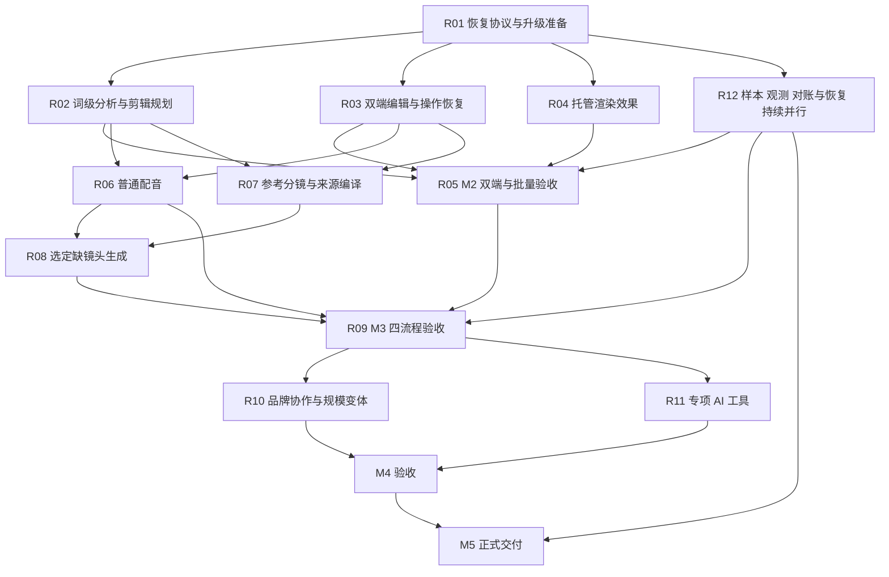

# Video AI Studio 项目开发规划

2026-11-04最新交付：用户三条真实商品成片（49.567/52.467/28.7秒）与同任务Plus/Flash对比、质量及费用证据已完成，见[本批交付进度](development-progress.md#2026-11-04-用户真实成片与同任务双模型交付)。两生成候选均未通过构图要求；主片响度已修复并复验。新增独立预算2CNY、用量原价估1.22384CNY、实付待核，旧费用不重置；生产/真机及其余里程碑继续按原条件验收。

更新日期：2026-11-04。

本规划以现有项目继续开发，交付可独立完成制作、编辑、批量、审核和领取的网页与微信小程序。本轮按用户要求优先完成真实渲染、自动剪辑、补镜头及人物/人脸替换的可用业务链路，再组织对应真实效果和双端综合验收；普通配音、品牌生产、协作及其他专项 AI 范围继续保留。

保留 A–H **8 个工作部分、59 项任务**和 M0–M5 **6 个交付里程碑**。R01–R12 是这些任务的执行批次，用来安排增量和依赖，不增加任务数量；一个任务跨批次时按剩余子项推进，整体通过才关闭。

产品范围遵循[综合产品方案](integrated-product-design.md)，模块约束遵循[详细设计](detailed-design.md)。本规划替代旧路线中已过时的待建设状态和启动队列；历史结果保留在[执行进度](development-progress.md)。开源项目的采用边界和源码入口见[参考项目实施映射](open-source-reference-plan.md)。

## 当前起点与交付目标

当前仓库已包含账号、版本编辑、批次、审核、费用、参考素材匹配，以及补镜头/人物工具的授权→报价→任务→采用和恢复代码。本轮按六个执行包已新增场景版本、严格多模型合同、完整讲话证据消费、质量finding、双端选模及分项评审、正式交付守卫；具体状态见[执行进度](development-progress.md)及[Q001–Q054问题清单](quality-issue-register.md)。本轮完整门已通过1061 passed、74 skipped，ALL: PASS，见[完整日志](../data/testing/work-packages-20261104/quality-gate.log)；人物输出修正时的 **858 passed、74 skipped，ALL: PASS，669.69 秒** [历史日志](../data/testing/ai-production-20261104/quality-gate-person-output.log)及更早825/74均保留为历史，当前软件检查以1061/74为准。图片exact底层边界尚未修复，已知ICE原生Image组合新增付费前守卫；软件合同不替代真实效果或平台验收。

M0已通过，M1指定样本的受限真实媒体闭环已通过；**M2整体未验收**，E01–E03仍有剩余。T2V/官方人物样例已有有限QC，自动剪辑三秒结构裁剪成片受限通过。ICE A部分通过但Logo多1帧；四图诊断已完成，A/B/C均31帧、D为29帧，没有目标30帧方案，图片exact组合仍关闭。原B重叠fade未提交，本轮新ICE共3条且不再追加。FaceFusion本地首48帧纯脸技术样例已有，非商业模型仍阻止生产catalog。详细事实见[本轮进度](development-progress.md)与[AI制作说明](ai-production.md)。

[自动剪辑业务报告](../data/testing/ai-production-20261104/auto-edit-real-source.md)记录实际API/Planner/worker/持久版本/manifest及双幂等/哈希；后续[实际成片QC](../data/testing/ai-production-20261104/auto-edit-real-v1.qc.md)确认原云Job `a3da7e2b5d7c4ae58dfc1ea68ae01755`的72,526字节文件为3秒、480×832/30fps/90帧，完整解码及源0–3秒按索引对照通过，均值SSIM 0.988093。单素材结构裁剪真实成片受限通过；有损相似度不等于像素无损。生产路径仍因缺真实 `shots` 返回 `analysis_not_ready`，语义选片、ASR和多素材排序未验收。

既有控制面 schema 已推进至 0023，但没有本轮部署证明。2026-11-04 只读核对发现旧项目 `/opt/video-ai/project.retired-20261028` 已退役，8000 端口未运行；历史 M1 `control v8 / gateway v11` 不是当前在线状态。标准 Docker 运行其他项目，本轮不重启或替换。后续发布前仍须核对真实环境、schema、未结束远端任务和费用。

| 工作部分 | 任务数 | 已有基础 | 本轮规划的重点 |
| --- | ---: | --- | --- |
| A 可靠运行基础 | 9 | 完成事务、执行围栏、产物去重、账务和 PostgreSQL 并发基线已验收 | 收敛所有恢复入口、统一任务读模型、自动过期恢复和运行配置 |
| B 真实媒体链路 | 6 | M1受限闭环保留；自动剪辑单素材真实成片受限通过，ICE A部分通过；四图诊断未找到精确图片结束方案 | 保留可复现缺陷和exact组合关闭状态；取得可靠合同/方案证据后再处理，补真实分析/语义、效果与费用 |
| C 双端制作工作台 | 12 | 账号、素材、计划、编辑、审核、交付和费用源码已接入 | 共用操作语义、恢复协调、编辑体验、真实效果和设备验证 |
| D 基础批量生产 | 5 | 批次配置、固定轮次、调度、审核和打包源码已接入 | 双端各 10 项真实链路、部分失败、容量、费用与领取 |
| E 参考与口播制作 | 7 | 参考范围、手工分镜、来源采用版本和补镜头业务源码已有；单条T2V技术QC通过 | 生成效果/采用到Timeline、口播建议、TTS、智能编导和真实综合验收 |
| F 规模生产与协作 | 5 | 模板、成员、批次和所有者审核底座已有 | 商品品牌资料、模板、角色、显式变体与提醒 |
| G 扩展 AI 工具 | 9 | 工具/授权及人物输出准入已有；官方人物有限QC及本地FaceFusion首48帧纯脸技术样例已有 | 纯脸非商业模型仍不能入生产catalog；补可商用模型/权利、客户授权全链与细节效果 |
| H 质量运营与交付 | 6 | 本机观测、加密恢复、发布工具和旧库升级检查已有 | 固定样本、生产恢复、独占接管、回滚、对账和发布 |

最终产品覆盖四条流程：自有素材自动剪辑、参考驱动成片、文案或现有口播成片、批量变体生产。每条流程均保留人工确认、版本修订和局部恢复。

网页与小程序的业务能力、权限和结果一致。网页使用宽屏工作区与快捷操作，小程序使用步骤、片段条、上下文工具和精确参数；手机可独立完成，不以跨端演示替代手机验收。

## 下一轮工作与验收

已开始按六包自动推进，首批交付目标仍为：商品展示、口播讲解各5组真实项目，每组使用5–10段素材，制作30–60秒、内容完整、音画协调、可以局部修改的成片。模型接入、场景配置和真实效果分别验收；以下六个执行包映射已有A–H任务及R批次，不增加59项任务计数，也不替代M2/M3关闭条件。

稳定质量采用场景规范、可信素材事实、模型专属提示词与参数、确定性渲染、质量检查及局部修正的组合。场景规则可配置并版本化，用户内容保持开放；提示词优化在固定样本和独立验证集上离线评估，通过后再发布。新增场景主要扩展规则、证据和评测样本，共用现有制作管线。

| 执行包 | 主要工作和交付物 | 验收条件 | 原批次与任务 |
| --- | --- | --- | --- |
| 1 场景规范与质量基线 | 建立商品、口播两类场景配置，定义目标、受众、事实、叙事、必需镜头、选镜权重、节奏、声音、画幅和质量规则；整理真实素材、制作要求、人工参考成片及失败反例 | 两类场景使用不同规则；缺失测量不冒充零分；事实、技术、叙事、画面和声音分项评审，关键错误不能被总分抵消；保留未参与调参的新素材复验 | R12/H02，R02/C06，R07/E02 |
| 2 多模型执行基础 | 同一业务支持多个模型及供应商适配；分别登记输入、参数、输出、版本、许可、价格和提示词模板；双端提供自动选择与指定模型，并解释可用范围 | 首批选定同类任务至少两种合格模型可执行和对比，具有跨供应商适配证据；不同输入模式的接口不冒充同输入任务的替代模型；不支持的参数在报价前明确拒绝 | B01，R04/R06/R08/R11，C12 |
| 3 真实分析与语义规划 | 接入真实镜头、词级转写、可用区间、主体、景别和质量证据；依据场景及必需内容选镜，将计划和来源编译到Timeline | 多素材有来源和选镜理由；保留完整词句、关键事实及必需镜头，控制重复；没有证据时报告素材或补拍缺口，不能用整段回退冒充语义理解 | R02/R07，B03、C06/C09、E01–E03/E06 |
| 4 稳定渲染与声音 | 依据供应商合同或可复现实证解决图片出点，必要时验证另一托管渲染实现；补字幕安全区、真实转场、原音/配音/配乐混合、术语发音、人声优先、尾音和输入规格适配 | 逐帧核对边界与轨道，连续听审声音和同步；不同画幅、帧率及手机素材实测；未通过的效果组合继续在收费前拒绝，不能用提示词修饰渲染缺陷 | R04/R06，B04/B05、C08–C11、E05 |
| 5 受约束生成与场景选模 | 将镜头主体、动作、机位、时长、相邻关系和不可变事实映射成各模型请求；限定候选及预算，比较后显式采用；用真实场景评测建立自动选模规则 | 默认选择可解释且有对应场景/能力证据，不按目录首项或未经校准的静态分数冒充质量排名；候选检查主体、动作和连续性，采用后进入Timeline；只重做选定缺口 | R07/R08，专项复用R11，E03/E04、G01/G08 |
| 6 局部修改与双端完整验收 | 用户锁定满意镜头，改单句字幕、配音或单个候选；复用未变化的结果，检查相邻衔接；网页与原生小程序各自完成制作、修改、恢复、审核及领取 | 局部修改不覆盖已批准内容，只对确需重新制作的部分报价；实际模型、输入/场景/提示词/时间线版本、质量报告、审核和费用对应；平台/真机与真实媒体分别取得证据 | R03/R05/R09，R12贯穿 |

### 2026-11-04 首轮落地状态

| 执行包 | 当前已实现 | 下一项可核对交付 |
| --- | --- | --- |
| 1 | 两类draft场景、version/hash/提示绑定、五维质量及基准用途隔离合同；12目标仅planned、0 ready | 授权商品/口播各5真实项目、人工参考和独立新素材，形成真实基线 |
| 2 | 模型专属输入/参数/提示合同和供应商字段映射、报价冻结、自动/指定选择及双端参数表单 | 接通并分别验收至少两种同输入任务合格模型；禁用的标准网关示例不算已接入供应商 |
| 3 | 词句ID/时间/对齐/说话人证据、transcript/2，完整讲话选片和编辑保存/渲染来源守卫 | 接入真实托管词级ASR与镜头测量，验证语义、多素材、停顿和重复建议 |
| 4 | 结构与感知检测范围分开、统一finding及边界/尾音测量合同；已知ICE Image新付费前阻止，旧远端可查 | 取得图片时间合同/可复现替代方案，补转场、混音/TTS及格式真实矩阵 |
| 5 | 提示模板/版本、场景上下文、选模依据和最终供应商参数冻结；无依据多候选拒绝 | 固定/独立素材真实评测后开放场景排名，验收候选比较及局部采用 |
| 6 | 双端场景/选模合同及Node/原生TS通过；本地口播编辑集成专项172 passed；项目级分项质量评审已接API | 质量结论与旧批准/下载联动、双端评审界面和实际项目/平台/真机完整闭环 |

本轮无新增云调用或费用。场景规则和权重均待真实校准，合成ASR只验证软件消费合同，不证明真实识别、语义或成片质量。质量评审绑定项目、审阅身份、文件hash和证据，明确不授予商业或发布准入；原审核及正式交付仍需独立满足其约束。新全量门、联动守卫及真实媒体结果在[执行进度](development-progress.md)更新，不叠加重合专项数字。

### 多模型选择与执行规则

多模型验收分为可接入、可手动选择、可按场景自动选择三个层次。本轮已在ProviderRegistry及模型目录上增加版本化输入/参数/提示词映射，双端已接选择；实际供应商适配、真实场景评测及受控回退仍按上述执行包验收。理解与编导、视频生成、配音、人物工具和质检分别按能力选模，不要求每个模型承担所有任务。

自动选模在报价前完成，冻结所选模型、输入引用、场景规则版本/hash、提示词版本、规范参数及最终供应商参数、参考素材和价格版本。唯一合格模型可自动选择，无场景时可用明确运营默认，两者不代表质量排名；多个候选无相应已验收场景依据或证据并列时要求明确选择，不按目录首项兜底。执行时不能静默换模；需要更换时明确形成新候选和对应报价。原任务结果未知时继续查询原ID，不启动替代模型来掩盖未知状态。已批准镜头默认保留配置；供应商更新或提示词、场景规则变化后，先用同一基准集回归并用新素材复验。

评测同时记录模型质量、拒绝情况、人工修改次数和耗时、交付耗时及每条合格成片的实际费用。相同制作要求及素材下比较各模型，保留各自必要的参数适配；统计中包含未被采用的候选成本。随机生成保存真实产物及完整可控配置，不把seed或供应商版本标签视为逐像素复现保证。

### 并行顺序与首批退出条件

执行包1和2先并行，包3和4并行；基于场景、模型和素材证据完成包5，再用包6收口。模型协议和页面合同可以提前准备，场景自动选模的质量排名须等待真实评测。R01中影响新链路的可靠性修复随对应执行包落实，R12的质量、账务、恢复和隔离环境准备全程并行。

首批先完成少量项目校准，再扩到商品和口播各5组，并用独立新素材复验。交付每组的成片、可修改项目、版本/来源记录、质量报告、人工修改记录和实际费用。关键事实错误、明显技术错误不得进入正式交付；叙事、画面和声音分别评分，先建立基线，再锁定后续量化门槛。首批10个项目不替代最终30个核心项目样本或M2双端各10项真实批次。

纯换脸的商用模型和权利、人物细节质量作为专项并行推进；已有非商业短样例不解除生产限制。商品、口播通过后按相同流程验证文旅、访谈和品牌批量，保留原四条创作流程及其他AI工具范围。

## 架构与开源参考的采用方式

继续使用 FastAPI、PostgreSQL、现有 Job/Workflow、ProviderOperation、预算和统一完成事务。Canonical Timeline 是编辑与渲染交换的真源，分镜、计划、来源和模板使用不可变版本。

生产保持 `PROVIDER_MODE=api_only`、`ASSET_STORAGE_MODE=external`。客户端直传对象存储，控制面处理元数据、权限、编排和费用；媒体解码、分析、模型推理和渲染由外部托管服务执行。不把参考仓库的本地 FFmpeg、Chromium、Torch 或模型权重直接引入控制面，也不因采用开源模型自动新增自备或租用 GPU 的部署方案。

采用顺序为：固定上游版本与许可 → 提取合同、算法和边界用例 → 映射现有模型与操作 → 离线验证 → 真实托管服务样本 → 双端验收。许可适用的代码复用记录来源、版本、改动和署名；模型、音色、字体、音乐及素材单独登记。

| 开发方向 | 主参考 | 进入本项目的形式 |
| --- | --- | --- |
| 原片与中文口播剪辑 | video-use、FunClip；本地 Jianji | 源区间、词级映射、剪辑建议和帧级边界用例 |
| 分析证据 | FunASR、WhisperX、PySceneDetect | 托管分析结果合同、语言/模型版本和切点对照 |
| 双端编辑 | OpenReel、Shotcut；Kdenlive 专项 | typed operations、隔离草稿、撤销和媒体行为基准 |
| 参考创作 | NarratoAI；Hypit 设计 | 观察证据、分镜、语义锚点和明确的候选采用 |
| 模板与批量变体 | HyperFrames；OpenMontage 设计 | 参数 schema、冻结计划、执行阶段和产物复用 |
| 配音与多语言 | CosyVoice、Qwen3-TTS、VideoLingo | 逐段 TTS、声音提示复用、审校、真实时长和字幕对齐 |
| 视频与专项工具 | Wan2.2、Chatterbox、MuseTalk | 能力专用 Provider 合同、候选、授权和真实样本 |

Hypit 是附条件许可，对外托管、多租户和商业分发须按其条款取得授权；OpenMontage 为 AGPL。二者先作为设计参考，代码采用需完成相应许可核对。Remotion、F5-TTS、Fish Speech、IndexTTS 等沿用[参考映射](open-source-reference-plan.md)中的条件，不把仓库主许可证推导为全部权重或托管用途许可。64 项[筛查快照](../third_party/open-source-screening-2026-11-04.json)固定在 2026-11-04，不自动批准后续版本。

## 里程碑与执行依赖

| 里程碑 | 任务范围 | 当前状态 | 本轮退出条件 |
| --- | --- | --- | --- |
| M0 可靠基础 | A01–A09 | 历史基线已验收 | 保留结果；R01 新增协议和恢复问题通过当前版本回归 |
| M1 真实媒体闭环 | B01–B06 | 指定受限子集已验收 | 保留已有结果；新分析/渲染规格单独扩展能力矩阵 |
| M2 双端制作与基础批量 | C01–C12、D01–D05，基本 H01 | 源码较完整，整体未验收 | R01–R04中M2必需子项及R05/必要H增量通过；网页/手机各自单条与10项批次完整通过 |
| M3 四条创作流程 | E01–E07 | E01–E03部分实现；E04生成业务源码已接入，单条T2V技术QC通过 | R06–R09通过，四流程共享素材、版本、费用和交付 |
| M4 规模与完整 AI 能力 | F01–F05、G01–G09 | 工具/授权入口及人物有限QC已有；本地纯脸首48帧技术样例通过，商业生产catalog仍受许可限制 | R10/R11逐项通过，全部目标能力双端可独立操作 |
| M5 正式生产交付 | H01–H06，复核 M0–M4 | 部分本机准备完成 | 生产容量、费用、恢复、发布与最终交接通过 |

阶段约束交付，开发可并行。R03 与 R04 可在分析合同草案确定后同步推进；R06/R07 可在 M2 等待外部验收时开发。R07 可编译全素材已就绪的分镜；存在缺口的分镜保持草稿，补拍或 R08 候选采用后才能正式渲染。R12 从 R01 开始，不是最后才启动。

## 执行批次与验收

优先级沿用原任务：P0 处理可能损害权限、执行、费用或交付一致性的缺陷及必要运行基础；P1 完成四流程、双端、基础批量和相关质量交付；P2 完成品牌规模、协作与专项 AI；P3 是另列的待确认增量。已验收基线不重新计入待开发，当前发现的 P0 增量在开放相关能力前解决。

### R01 恢复协议与生产升级准备

映射 A09、C02/C12、D03、H01/H04。完成事务和产物唯一约束继续复用，新增工作集中在入口一致性和运行生命周期。

- 将旧 retry/cancel 和双端回退收敛到已有安全 JobAction 协议；任务视图统一提供状态、attempt、execution_generation、可执行动作和原回执。缺字段时停止动作并同步，不能回退弱入口。
- 明确过期 Workflow 的恢复调度者、扫描间隔、租约续期、告警和部署配置；恢复时继续核对数据库实例、远端身份和未知费用。
- 给媒体网关建立 schema 版本、显式迁移、兼容检查与旧库升级回归；生产密钥的必要约束由运行时和发布预检共用。
- 复核当前 0023 控制面迁移、旧空间归属、源停写围栏和恢复库隔离，准备升级与回滚方案。

验收覆盖同键固定回执、异正文冲突、旧代次拒绝、旧端点绕行、Worker 崩溃及租约恢复、迟到结果和未知账单。PostgreSQL 多连接验证恢复竞争；测试不向供应商新增请求。生产接管和执行另按既有授权范围推进。

### R02 词级分析与可审阅剪辑规划

映射 B03、C06/C09、E01/E03/E06、H02，参考 video-use、FunClip、FunASR、WhisperX、PySceneDetect 和本地 Jianji。

- 新增版本化分析与转写快照，保留源对象身份、稳定 segment/word ID、语言、可选说话人、原文/显示文字、可空时间和置信/对齐状态。同步更新 Worker、回调、`capture_transcript`、公开 DTO 和双端缓存；旧句级数据继续可读。
- 统一源时间与成片时间的表示和映射；计算使用 FrameClock 整数帧。大型转写按块或受控 sidecar 存取，缓存绑定内容、模型、语言、参数和预处理版本。
- SpeechCut 输出稳定词 ID、保留/删除建议和理由；服务端从冻结证据计算区间，用户接受后才生成编辑版本。没有可靠词时间时保持句级能力。
- 修复顺序贪心分配：先满足必需/锁定槽位，再优化评分；区分来源资格和输出最短/最长帧数，报告不可满足约束。

验收包含重复词/重复句、数字专名、混合语言、静音、重叠说话人、未知对齐、VFR 和源/成片时间重映射。必须通过“槽A可用a/b，槽B只能用a，则A=b、B=a”的可行分配用例；不可行时明确缺口，不隐式变速、拉长或丢镜头。新分析不改变旧编辑快照。

### R03 双端编辑操作与恢复协调

映射 C02–C04、C06–C12，参考 OpenReel 的操作/隔离编辑会话，以及 Shotcut/Kdenlive 的编辑规则。

- 在现有 operations 与 CAS 版本接口上增加统一操作协调层，覆盖裁切、分割、排序、字幕、音轨、叠加、转场及新增建议采用。复用纯时间计算和 schema，两端分别实现界面。
- 网页围绕当前项目、制作模式、版本、预览和下一步组织；任务/费用可在制作上下文查看。明确草稿、已保存版本和当前媒体预览的区别。
- 同一协调器管理 pending 操作、原键/正文、回执查询、账号/项目清理与迟到响应；先查询未知结果，只有服务端证明可放弃时解除。
- 统一 TaskView/DTO 与错误码，建立 API 类型/端点漂移检查；扩展操作不引入第二套版本或恢复系统。

验收包括成组操作全成功或回滚、过期 base、两页冲突、撤销/恢复、触摸取消、锁轨、连续分割帧数、字幕锚点、独立音轨保持、刷新/403/断网和隐藏页面迟到回执。原回执只能确认原操作，不能覆盖更新后的 head。

### R04 托管渲染效果矩阵

映射 B04/B05、C08–C11、H02，参考 Shotcut 的实际媒体行为、HyperFrames 的冻结计划和混音方法。

2026-11-04：A原作业 `06b05feb7ef3456681a4bc73b71bd741` 的[实际成片QC](../data/testing/ai-production-20261104/ice-effects/effects-basic-v1.qc.md)为**部分通过**：中英字幕、透明图片Contain/位置、独立440Hz音轨、实测增益0.549783及tri淡入约0.601秒/淡出约0.811秒按AAC容差通过；Logo实际frame15–135而非目标15–134，多1帧，exact Timeline整组未通过。

2秒四图Job `b2e5ec2563cf497fa265fe7aad7a124d`的[最终诊断](../data/testing/ai-production-20261104/ice-effects/image-boundary-v1.qc.md)、[全部60帧QC](../data/testing/ai-production-20261104/ice-effects/image-boundary-v1.qc.json)及[原云回读](../data/testing/ai-production-20261104/ice-effects/image-boundary-v1.cloud-status.json)已保存。提交/回读Timeline逐字段一致，排除UI改写；两套独立60帧QC结果一致。目标frame15–44共30帧：原配置A、去Duration的B、去Out的C均为15–45共31帧；Out和Duration各减1帧的D为15–43共29帧，没有安全精确候选。

原因尚未证明，未猜测更改`ice-timeline/4`时间编译；858/74保留为图片诊断前的历史门。本轮新增统一finding和已知ICE原生可见Image的付费前守卫，底层结束边界仍未修复，图片exact组合未验收。四图B为图片实验变体，原B重叠fade是另一条尚未提交样例。本轮新ICE总3条，到此不再追加；实际账单待核，旧M1计数不变。原检查条件见[A/B验收说明](../data/testing/ai-production-20261104/ice-effects/acceptance-instructions.txt)，不把诊断完成或通过子项当作整组验收。

建立按供应商/模型/版本/规格/效果组合的能力矩阵。优先验证字幕字体/中文换行、独立配音与配乐、多音轨及淡入淡出、图片/视频叠加、fit/透明度，以及真实重叠转场。每项确认输入、预计时轴、费用计量和输出检查。

报价、入队和远端提交都校验同一能力与版本；保存编辑可以保留未开放效果，生成入口清楚列出阻塞项。参考项目的效果实现只用于编译、样本和外部适配，真实服务必须取得对应证据。

验收须有实际文件、完整解码、规格/帧数检查、字幕抽帧、听审、来源哈希和费用记录。不能仅增加 features 字符串就开放效果，也不能静默删除不支持的轨道。

### R05 M2 双端单条与基础批量验收

映射 C01–C12、D01–D05、基本 H01及H04。以已验收的 R04 组合交付自动成片。

R05 依赖 R02 的分析兼容、槽位分配和字幕映射等 M2 必需子项；更完整的语义口播建议继续在 E06/R09 验收，不把整个 M3 前置为 M2 的关闭条件。

分别仅用网页、仅用手机完成：登录 → 上传/核验 → 模板/计划 → 修改片段/字幕/音量 → 预览 → 审核 → 正式领取。首轮产品样本以 5 段素材、30 秒竖屏为目标，输出规格以提交前已开放能力为准。

两端再各自执行 10 项真实批次，覆盖共用/覆盖配置、预算或容量等待、部分失败、取消、断网、原任务恢复、固定版本审核、真实 ZIP 和手机逐项保存。检查成功项、已生成版本和已有费用不因失败项重做。

M2 关闭需具备微信登录/显式绑定、开发工具和 iOS/Android 实测；源码、离线 Page 检查和十项元数据计划只作为中间验证。权限撤销、链接过期、哈希不符、空间不足和相册拒绝均应给出准确恢复结果。

### R06 普通配音与多语言制作基础

映射 E05、C09/C12及G03/G04的可复用基础，参考 CosyVoice、Qwen3-TTS、VideoLingo。先交付标准音色与普通文案配音，再按独立授权与验收开放克隆。

冻结文本、读音、语言、音色、模型、价格及分段参数；逐段 Job 绑定稳定操作身份，已提交段只查询原远端。成功音频保存实际时长、采样率、声道、源文本和模型证据，采用为 Asset 后通过已有编辑操作插入音轨。

试听与正式生成分别说明计费和复用方式。修改一段只重做明确选择的段；译文/发音先审校。词/句对齐来自最终音频及已声明的分析步骤，不能将文本估算当作实际时刻。

验收覆盖数字/专名、中文/目标语言、长文切句、音色一致性、失败段恢复、未知收费和字幕同步。超时长需要改文案、明确变速或调整镜头，不截断后静默成功。配音、克隆、声音转换、口型分别验收。

### R07 参考分析与分镜来源编译

映射 E01–E03、C07/C09，参考 NarratoAI 的观察证据和 Hypit 的词级语义锚点/显式来源设计。

- 外部视觉服务输出范围内的镜头、关键帧、动作/场景/风格描述及证据；未知项保持未知。智能编导输出 schema 约束的分镜，事实、旁白、画面文字和声音要求分别保存，用户确认并锁定。
- 匹配继续使用现有 ShotRequirement、素材标注、候选报告和来源采用版本；模型语义与用户标注分开，来源变化重新核对。
- 编译冻结分镜版本、来源版本、脚本/TTS版本和 compiler_version，建立 `story_shot_id ↔ selection_id/clip_id` 映射，生成现有编辑文档及不可变 TimelineRevision。
- 分镜中的词/句锚点随最终配音重算；对毫秒转帧余数、图片停留、源容量和输出时长给出明确规则。

验收覆盖同键只编译一次、来源/用途/授权变化、锁定不被覆盖、重复素材、超长旁白和镜头总帧数。含 reshoot/unassigned 的分镜可保存缺口草稿，但不能正式报价/渲染；全就绪分镜应可编辑并交付。

### R08 选定缺镜头生成与候选采用

映射 E04、C10/C12、G01基础，参考 Wan2.2 的生成输入/分支与 Hypit 的明确结果复用。

2026-11-04：选定分镜绑定、模型参数、报价/任务、原请求恢复、候选及显式采用为项目素材的后端/双端代码链路已实现。真实 `wan2.2-t2v-plus` 单条文件已取回并完成有限 QC，估 0.70 CNY、实际账单未核；这不是双端从分镜到交付的完整验收。当前采用先创建 Asset，再由用户在分镜/剪辑中明确选择；下述来源版本与 Timeline 编译连接、真实局部重做及综合效果仍需交付。

只对用户选择的缺口创建报价和生成任务，冻结每镜头的参考素材、提示词、约束、模型、seed及规格。候选保存真实媒体、质量结果、输入来源和费用；采用创建新的来源版本和 Timeline 编译版本，保留旧候选与未选缺口。

验收包括单镜头重做、重复确认、部分成功、未知提交、取消后迟到、预算变化、候选质量不达标及授权失效。修改字幕或布局可复用已批准镜头，不据此重复生成。生成效果按固定样本审核，动作/身份一致性作为单独维度。

### R09 M3 四流程综合验收

映射 E07，并复核 C、D。依赖 R02–R08 的相关结果和 R05 的双端真实证据。

自有素材自动剪、参考创作、口播/文案配音、批量变体均通过同一素材、分镜/计划、版本、任务、账务和审核系统。每条流程分别做网页与手机独立样本，验证局部改动、失败恢复、继续编辑和正式交付。

必须贯通“参考 → 分镜 → 已有素材/补镜头 → 配音与编辑 → 审核 → 领取”，并保留输入、版本、真实费用、时长和人工修改记录。有缺口、未验证效果或单端缺功能时保持未完成。

### R10 品牌协作与规模变体

映射 F01–F05，参考 HyperFrames 的参数化模板、Hypit 的内容/样式分层；Kitsu/Zou 仅作审片协作专项参考。

分三步：先建立客户/商品/品牌资料与模板版本；再实现邀请、角色、项目权限、逐帧意见与权限回收；最后增加显式多商品/开场/语言变体、规模检索及用户主动开启的提醒。

模板参数、资料事实、素材引用与已确认执行配置分别冻结；变量组合在报价前列出实际数量和上限。审核绑定精确 Artifact 和版本，撤销权限作用于后续执行与交付。

验收覆盖资料变更不影响历史、客户品牌隔离、普通成员越权、撤销后访问、模板兼容、手机参数编辑、多变体预算及局部恢复。批次上限以容量实测确定。

### R11 专项 AI 工具逐项交付

映射 G01–G09。先完成统一工具目录、授权和结果回素材库，再按三波推进；每波内部按真实托管可用性并行，不缩减必需能力。

本轮已实现人物/纯换脸双端入口及授权、报价、任务和采用链路。官方人物示例的严格解码、基本人物外观/服装替换及水印检查通过；手部、口型、连续视听和客户授权/托管归档/采用仍未验收。人物固定720P假定已纠正，模式帧率及实际尺寸回归纳入历史858/74完整门；专业模式未由标准样例实测通过。

[FaceFusion本地技术报告](../data/testing/ai-production-20261104/facefusion-probe/report.md)记录独立venv/CPU首48帧、2.002秒、1282×720、23.976fps局部换脸，服装/身体/背景在该样本中保留，预览有AI标识。约1.6GB模型位于独立探针目录，未改主项目源码或依赖；所用模型非商业限制仍阻止生产catalog，其他附属组件许可与客户权利也未据此放行。主部署继续api_only/external，不将本地探针自动变成主营Provider。商业模型/权利、资源、全序列和既有授权/托管结果合同仍待验收；阿里云旧纯脸服务的当前账号限制也保持。

| 波次 | 能力 | 主要参考 |
| --- | --- | --- |
| 第一波 | 视频增强修复、图像/封面、多语言成片 | Real-ESRGAN、Qwen-Image、VideoLingo；基础配音复用 R06 |
| 第二波 | 声音克隆、声音转换、数字人/口型 | CosyVoice/Qwen3-TTS、Chatterbox；RVC/GPT-SoVITS为定制专项，MuseTalk为口型 |
| 第三波 | 动作复刻、人物/人脸替换 | Wan Animate、LivePortrait 等专项；每种能力确定支持范围和授权 |

每项交付双端输入/参数/候选/采用/局部重做/恢复，并验证生成前、执行前、交付前所需授权。产物进入普通编辑与批量流程。声音转换不等同训练型音色定制，口型不等同全身驱动，图生视频不等同精确人脸替换。

按具体版本分别登记代码、权重、附属模型和托管服务许可；找不到符合用途的服务时保留明确依赖与评估，不把通用接口或隐藏菜单计作完成。

### R12 质量运营与正式发布

映射 H01–H06，自 R01 起持续进行，M5 最终关闭。

维护 30 个核心授权项目样本，按商家、个人创作者、代运营各 10 个组织，并为 AI 工具建专项集。记录每条输入/版本/实际媒体、质量评分、修改次数、完成率、P50/P95和实际费用。原建议核心完成率至少95%、主观质量至少4/5作为目标候选，正式验收前锁定样本、失败口径和各维度容差，不事后降低标准。

运行观测覆盖请求/Job/远端任务、Worker心跳、队列年龄、未知远端、预占与对账、失败和恢复。费用估算、可信预占、供应商账单及调整分开，跨币种不无依据合并。

生产验证同时覆盖元数据、媒体对象与网关状态；完成异地备份/密钥取回、源写入者物理围栏、独占接管、实例票据、兼容回滚与恢复目标实测。发布前执行当前源码的统一质量门、双端回归和授权环境演练，交付可复核包、迁移、配置清单、运行手册和能力报告。

## 59 项任务的状态与剩余工作

状态以当前代码和[阶段记录](development-progress.md)为依据。已验收项保留历史结论；新增范围由对应 R 批次交付。实现中、待真实验收和已交付分别记录，不计算没有依据的总完成百分比。

### A 可靠基础

| ID | 任务 | 当前状态与后续 |
| --- | --- | --- |
| A01 | 可复现开发验证基线 | 基线已验收；R01固定当前依赖、失败与回归基线 |
| A02 | 执行与结果数据约束 | 已验收；后续模型迁移保持业务唯一键与历史引用 |
| A03 | 统一任务完成事务 | 已验收；新增TTS/生成/编译继续复用同一事务边界 |
| A04 | 账务幂等与迟到费用 | 已验收；新计量单元与局部生成扩展相应证据 |
| A05 | PostgreSQL 并发回归 | 基线已验收；新增动作/报价/恢复补真实多连接用例 |
| A06 | 网页与 API 同源入口 | 已验收；新增脚本与路径同步允许列表 |
| A07 | 生产上传与证明边界 | 已验收；新媒体类型沿用远端核验与不可变身份 |
| A08 | 公开与内部接口权限 | 已验收；工具/协作扩展逐项校验 |
| A09 | 配置与持续质量门 | 基线已验收；R01增加安全动作、自动恢复和运行时配置检查 |

### B 真实媒体链路

| ID | 任务 | 当前状态与后续 |
| --- | --- | --- |
| B01 | 能力目录与接入合同 | M1受限通过；已增严格多模型输入/参数/提示/映射合同；R04/R06/R08/R11继续实际适配与验收 |
| B02 | 对象存储网关 | M1受限通过；R01网关迁移，后续双端/新媒体复验 |
| B03 | 分析服务 | M1受限通过；R02词级证据合同/完整讲话消费已实现，真实词级及R07关键帧/语义仍待验 |
| B04 | 渲染与媒体质检 | M1受限通过；已增证据finding与已知Image付费前守卫；R04底层边界、声音和效果组合真实验收 |
| B05 | 归档与短期访问 | M1受限通过；R05/R09真实新产物与批次领取复验 |
| B06 | 单条真实链路 | M1指定样本通过；R05产品场景和R09新增流程另验 |

### C 双端工作台

| ID | 任务 | 当前状态与后续 |
| --- | --- | --- |
| C01 | 用户、个人空间与跨端绑定 | 账号基础已有；R05微信登录、显式绑定、旧空间与跨端验证 |
| C02 | 双端接口与能力清单 | 部分已有；R01/R03统一TaskView、DTO、错误与类型漂移检查 |
| C03 | 小程序工程与导航 | 原生源码/离线检查已有；R05开发工具及iOS/Android实测 |
| C04 | 网页工作台 | 拆分与部分流程已有；R03项目制作上下文及恢复协调 |
| C05 | 双端素材中心 | 源码和网页整理已有；R05手机拍摄/选择、直传、恢复与检索 |
| C06 | 模板自动成片 | API/Planner/worker及双幂等、0–3秒/90帧实片受限QC通过（均值SSIM0.988093）；已增场景绑定、必需测量和完整讲话单元；真实shots/词级ASR/多素材语义仍待验 |
| C07 | 不可变编辑版本与冲突 | CAS/历史/恢复已有；R03新操作组合与双端并发复验 |
| C08 | 片段与画面编辑 | 已补口播手动裁切/分割/缩时/替换/replan的完整单元守卫及证据刷新；R03交互及R04/R05真实效果仍待验 |
| C09 | 字幕与音轨编辑 | 源码已有；R02词级映射、R03编辑、R04/R06真实声音与字幕 |
| C10 | 预览、质检与版本审核 | 元数据与部分流程已有；R04/R05实际媒体定位、质量与审核 |
| C11 | 作品、分享与交付 | 源码与部分网页流程已有；R05真实保存/分享/续签及批次交付 |
| C12 | 报价、预算与原任务恢复 | 源码已有；R01/R03安全动作，R05/R06/R08真实费用与局部恢复 |

### D 基础批量

| ID | 任务 | 当前状态与后续 |
| --- | --- | --- |
| D01 | 批次、子项与固定配置 | 已有实现；R05真实子项/版本/费用聚合验证 |
| D02 | 双端批次配置 | 十项离线/网页流程已有；R05手机独立配置与真实提交 |
| D03 | 公平调度、预算与恢复 | 源码已有；R01恢复协议，R05真实容量/取消/迟到费用 |
| D04 | 批量审核与领取 | 源码/离线IO已有；R05真实ZIP、内容一致性和相册结果 |
| D05 | 双端独立批量验收 | 待R05网页和手机各10项真实全链路 |

### E 参考与口播

| ID | 任务 | 当前状态与后续 |
| --- | --- | --- |
| E01 | 参考范围与分析 | 范围/用途/结构证据已有；R02/R07真实关键帧与语义 |
| E02 | 分镜策划与版本 | 手工分镜/确认/锁定已有；R07智能编导、事实与声音约束 |
| E03 | 素材匹配与补拍 | 候选/标注/来源版本已有；R07真实语义及来源到Timeline |
| E04 | 缺镜头生成与候选 | 双端绑定/报价/任务/采用源码已实现；单条T2V技术QC通过且运动有限，R08来源到Timeline及真实综合效果未验收 |
| E05 | 文案配音 | 通用Provider基础；R06普通配音、审校、对齐和音轨采用 |
| E06 | 口播成片 | 基础剪辑可复用；R02建议、R06声音、R07插镜/分镜连接 |
| E07 | 四流程综合验收 | 待R09双端独立真实验收 |

### F 规模生产与协作

| ID | 任务 | 当前状态与后续 |
| --- | --- | --- |
| F01 | 客户、商品与品牌资料 | 待R10版本化资料卡、事实和项目引用 |
| F02 | 自定义品牌模板 | 槽位/模板底座已有；R10双端编辑、变量和真实预览 |
| F03 | 成员、权限与审核协作 | 成员/所有者审核基础已有；R10邀请、角色、项目权限与意见 |
| F04 | 多商品与显式变体 | 批次底座已有；R10数量、预算、差异、局部恢复与容量 |
| F05 | 提醒与规模检索 | 检索部分基础；R10主动提醒、资格适配与规模场景 |

### G 扩展 AI 工具

| ID | 任务 | 当前状态与后续 |
| --- | --- | --- |
| G01 | 工具中心与授权闭环 | 本轮补镜头/人物/纯脸入口、原子授权和结果回素材已实现；R08/R11扩展其他工具并验收撤销/实际复用 |
| G02 | 增强与修复 | 通用合同基础；R11专项Provider、前后对照和真实质量 |
| G03 | 多语言字幕与配音 | 字幕基础已有；R06基础配音，R11翻译/对齐/语言版本 |
| G04 | 声音克隆 | VoiceProfile/授权基础；R11专用音色、试听、撤销及真实声音 |
| G05 | 声音转换 | 通用合同基础；R11源/目标声音、时长/内容与候选 |
| G06 | 数字人及口型 | Avatar基础；R11人物/音频绑定、口型和边缘质量 |
| G07 | 动作复刻 | 通用合同基础；R11驱动/目标授权、动作范围和样本 |
| G08 | 人物或人脸替换 | 业务合同及人物输出修正已过历史858/74门，官方人物有限QC与FaceFusion本地48帧纯脸样例已有；非商业模型仍阻止生产catalog，细节/商用权利/客户授权/双端专项待验 |
| G09 | 图像与封面生成 | 待R11品牌事实、候选、修订及编辑/封面复用 |

### H 质量运营与正式交付

| ID | 任务 | 当前状态与后续 |
| --- | --- | --- |
| H01 | 观测与可恢复错误 | 本机演练已有；R12覆盖全部开放能力及生产持续运行 |
| H02 | 固定样本与效果报告 | M1局部样本已有；R12建立30项目及工具专项、锁定指标 |
| H03 | 保留、删除与授权撤销 | 分享/授权基础已有；R12引用保留、外部删除和真实撤销验证 |
| H04 | 部署、迁移、备份与恢复 | 本机加密恢复/旧库升级已有；R01/R12网关、生产/异地、接管与回滚 |
| H05 | 容量与费用对账 | 调度/预占底座已有；R05/R10/R12逐级负载及最终账单 |
| H06 | 双端发布与最终交接 | 待M0–M4与H01–H05通过后完成M5 |

## 验证和交付记录

每批交付记录原任务 ID、代码差异/来源、迁移、合同、网页入口、小程序入口、测试与真实证据、未通过条件和下一批依赖。参考项目测试可转为本项目的行为用例，不能直接写成已经通过。

| 验证层 | 内容 | 对完成状态的作用 |
| --- | --- | --- |
| 离线合同与算法 | schema、时间映射、硬约束、编译、报价、幂等、失败与授权 | 证明控制面和算法边界 |
| PostgreSQL 多连接 | CAS、Claim、取消/回调/恢复、预算、版本和组动作 | 证明真实数据库并发语义 |
| 双端自动与交互 | DTO、网页控制器、原生Page、手势、未知提交及上下文 | 证明相关交互；原生离线不替代平台/设备 |
| 真实托管媒体 | 输入/输出文件、模型版本、解码/抽帧/听审、费用 | 证明具体能力和效果组合 |
| 端到端与生产 | 两端独立、10项批量、容量、恢复、发布 | 关闭对应里程碑与正式交付 |

根据改动执行必要回归，阶段关闭时对同一候选源码运行完整质量门与阶段验收；历史分批结果不相加为全量数字。没有新改动或未解决疑点时不重复无关检查。耗时/费用/质量先形成实测基线，再锁定服务承诺。

## 并行分工与近期顺序

| 工作线 | 主责角色 | 首批输出与交接 |
| --- | --- | --- |
| 控制面与数据合同 | 后端/数据库 | R01安全TaskView与恢复、R02分析/转写合同；供两端和集成使用 |
| 双端产品 | 网页/小程序 | R03共用操作和恢复协议、项目工作区、设备差异；对同一合同联调 |
| 媒体与模型集成 | 集成/后端 | R02分析、R04渲染矩阵，随后R06配音与R08生成 |
| 质量与运行 | 测试/运维 | R12样本、证据、观测、账单和发布准备；组织R05/R09验收 |

下一轮按上文六个执行包推进，先并行完成场景/评测定义与多模型基础，再并行完善真实分析和渲染声音，随后接通受约束生成与双端局部修改验收。既有云验证批次在3条新增ICE任务后停止，原B转场未提交；图片结束边界继续保留可复现缺陷及exact组合关闭，取得可靠合同或可复现实证后再处理。官方示例、本地非商业探针及首批项目均不替代客户授权或完整阶段验收；M2及后续里程碑按原条件关闭。

日历排期取决于团队容量、真实服务接入和设备/发布条件。先记录 R01–R03 实际吞吐及外部等待，再给出人员和日历承诺；批次顺序不等于固定周数。

## 外部条件与范围边界

实施前复用已有配置和台账，只集中列出确实缺失的条件。密钥通过安全配置提供，不进入聊天、Git或报告。

| 条件 | 影响范围 | 等待期间可继续 |
| --- | --- | --- |
| 微信账号、域名、开发工具及设备 | C01/C03/C05/C11、D05、F05、H06 | 合同、操作、Page和离线恢复验证 |
| 托管分析/渲染/声音/生成服务及许可 | R02/R04/R06/R07/R08/R11真实验收 | 映射、fake transport、样本规格、预检与报价 |
| 授权素材、品牌事实、人物/声音及评审 | H02和相关真实工具 | 固定样本清单、标注、质量维度与边界用例 |
| 累计费用和具体执行范围 | 所有真实收费调用 | 干运行、账务/恢复合同、计划和明确报价 |
| 生产访问、源围栏、对象/网关备份及发布条件 | H04/H06 | 可复核包、迁移、预检和隔离演练 |

历史记录的累计USD10约束、已确认CNY20体验包预付及既有待对账费用继续保留，不能按批次或月份重置。M1历史分析3/6、渲染6/6不改写；本轮Wan与ICE A/B单列，T2V估0.70 CNY、人物标准样例估3.12 CNY，合计估3.82 CNY均未核实际账单，且未计可能独立产生的OSS/ICE费用，不伪造已结算金额或美元余额。真实执行依据会话明确授权和可核对台账，不从本规划自动取得新增消费或发布权限。微信测试按执行时已确认的工具可用条件安排，等待时推进独立任务。

支付/套餐/发票、自动发布到第三方、商品替换专项/字幕擦除、完整专业剪辑器与自由工作流画布继续列为 P3 待确认增量。已经明确的双端编辑、基础/增强批量、模板、协作和G系列不因此缩减。

完整交付要求 M0–M5 必需任务全部通过，无未解决 P0；四流程和全部目标工具双端可用，真实成片关联输入、版本、质量、授权、费用和审核；生产容量、对账、恢复与发布有证据。外部审核、可发布和实际上线分别记录，阶段实现或提交审核不能替代完整交付。
