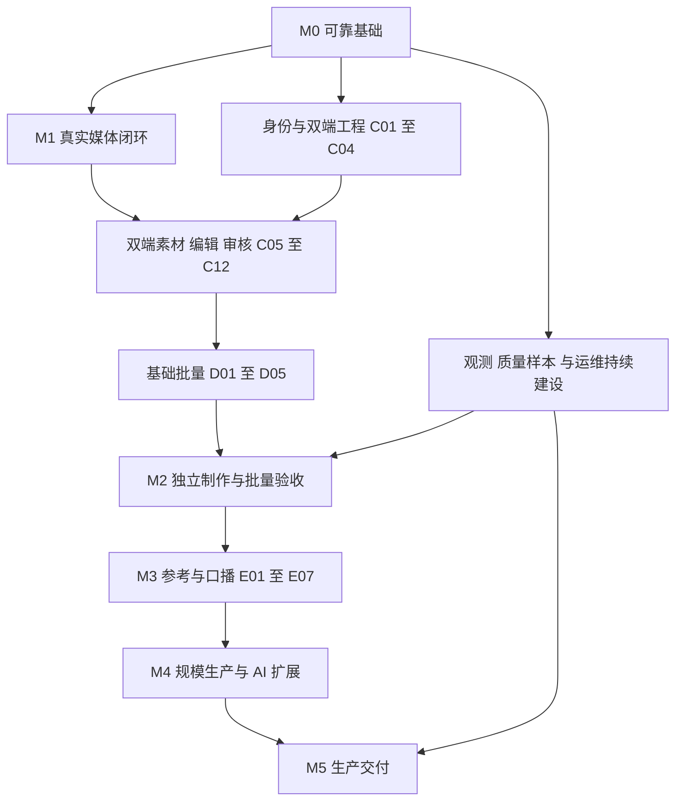

# Video AI Studio 开发任务与推进路线

以 [综合产品方案](integrated-product-design.md) 为产品范围、[详细设计](detailed-design.md) 为模块设计，推进功能对等的网页和微信小程序工作台。目标用户为电商商家、个人创作者和代运营等批量用户。小程序必须独立完成制作、编辑、批量、审核和交付，简化页面不缩减能力。

当前代码基线为 `cd959be`。后端控制面、任务编排和网页基础流程已有实现；真实服务闭环、小程序、完整编辑器与批量产品流程尚未完成验收。本路线使用阶段验收描述进度，不以接口数量或历史测试条数计算完成率。

完整 Goal 已按用户指令启动，实时状态见[执行进度](development-progress.md)。本文保留计划基线；已实现或已验收状态以执行进度中的代码和阶段证据为准。原按每个M阶段完成后集中验证；2026-10-18用户进一步要求微信开发工具被占用期间先推进其他工作并自动测试，现据此运行必要自动检查，完整阶段与微信真机验收条件不变。

## 当前进度与可复用基础

| 模块 | 当前代码证据 | 当前进度 | 后续任务 |
| --- | --- | --- | --- |
| 项目、素材、模板、时间线 | `app/models.py`、`app/schemas.py`、`app/api/routers.py` | 已有实体和 API；用户会话、成员、编辑版本和审核尚需完善 | C01、C05–C11、F03 |
| 自动剪辑 | `app/services/auto_edit.py`、`app/services/worker.py`、`timeline_engine/` | 已有评分、计划和编译；语义效果、人工锁定、局部重算需完善 | B03、C06–C09、E03 |
| Job 与工作流恢复 | `jobs.py`、`workflows.py`、`worker.py` | 已有幂等键、步骤、租约和恢复；完成阶段的一致性需要收敛 | A02–A05、C12、D03 |
| Provider 接入 | `provider_adapters.py`、`provider_registry.py`、preflight/smoke/acceptance 服务 | 已有 HTTP 适配与契约框架；不能据此认定真实媒体效果已验证 | B01–B06、E、G |
| 上传与存储 | `storage_attestation.py`、远端上传和完成接口 | 后端有远端 URI 与证明流程；网页文件上传仍走开发路径 | A07、B02、C05 |
| 预算和来源 | `budgets.py`、`provenance.py`、Consent/VoiceProfile/AvatarProfile | 已有预占结算和授权基础；需不可覆盖账务、版本绑定和交付闭环 | A04、C10–C12、G01、H03 |
| 网页工作台 | `index.html`、`app.js`、`styles.css` | 已有制作步骤与失败恢复；尚非完整编辑器，默认开发入口未打通同源 API | A06、C04–C12、D、E、F、G |
| 微信小程序 | 仓库未见小程序工程 | 待建设；交互示意不计作小程序实现 | C01–C03 及所有双端功能任务 |
| 参考分镜与批量 | 综合设计中的新增对象 | 待建设；单条 Job 基础不等于批量产品已完成 | D01–D05、E01–E07 |
| 质量与部署 | `scripts/quality_gate.py`、`.github/workflows/ci.yml`、Compose、Runbook | 有离线质量门与部署基础；缺双端端到端、真实 PostgreSQL 并发及生产效果证据 | A01、A05、A09、H01–H06 |

证据口径：前一轮已运行 Node 语法检查、`tests/frontend_retry.cjs`、Compose 配置检查及 Python 源码语法检查；本轮核对代码与设计，没有重跑完整 Python 测试。历史 fast/integration 测试有重叠，不能相加；静态通过也不证明真实供应商可用。A01 要重新建立当前环境的完整验证基线。

工作区已有 `scripts/quality_gate.py` 的测试顺序调整，实施时保留并区分来源，不顺带覆盖。现有设计文件与 README 改动同样属于启动基线。

## 优先级与任务状态

| 优先级 | 定义 | 推进规则 |
| --- | --- | --- |
| P0 | 阻止真实运行或可能导致重复产物、错误账务、权限/上传边界失效的问题 | 先复现和修复，基础验收未通过不进入对外试用 |
| P1 | 首个完整产品所需的四条流程、双端编辑、基础批量与真实交付 | 按依赖推进；M2 可先形成受限试用，M3 完成四条流程 |
| P2 | 完整目标中的规模生产、协作和扩展 AI 能力 | 不挤占 P0/P1，但属于完整 Goal 的必需范围 |
| P3 | 尚未确认纳入产品的新增商业或平台功能 | 单独登记；确认范围后再排期，不阻塞当前 Goal |

所有任务初始执行状态为“待开始”。表中“已有”“部分”“待建”“待实测”描述可复用基础，不表示任务已完成。执行时记录：待开始 → 进行中 → 待验证 → 已完成；缺少外部条件记录“受外部条件阻塞”和解除条件，不把受阻任务改成已完成。

建议每个任务采用以下记录：任务 ID、责任人、代码提交/差异、迁移、接口、网页入口、小程序入口、测试命令与结果、真实验证证据、遗留问题。后端或基础设施任务不强求有界面，但所有用户功能必须填写双端入口与验收结果。

## 阶段与依赖关系

| 里程碑 | 范围 | 通过后具备的能力 | 当前状态 |
| --- | --- | --- | --- |
| M0 可靠基础 | A01–A09 | 启动、权限、上传和任务完成一致性可验证 | 有基础，未通过本轮完整验收 |
| M1 真实媒体闭环 | B01–B06 | 经真实存储、分析、渲染取得可播放成片 | 指定样本/受限子集已验收，见执行进度 |
| M2 双端独立制作与基础批量 | C01–C12、D01–D05；H01 的基本观测 | 手机和网页各自完成自动剪辑、编辑、审核、交付及批量任务 | 待建设与集成 |
| M3 四条创作流程 | E01–E07 | 参考驱动、生成补镜头和口播制作与自动剪辑/批量连通 | 待建设 |
| M4 完整生产与 AI 能力 | F01–F05、G01–G09 | 三类用户的规模生产、协作及目标 AI 模块 | 部分后端基础，产品待建设 |
| M5 生产交付 | H01–H06，并确认 M0–M4 全部通过 | 真实效果、容量、对账、恢复与双端发布具备证据 | 待验收与发布条件 |

阶段约束的是交付，不要求所有开发串行等待。身份契约和小程序工程可与真实 Provider 接入同时准备；参考拆解可在分析能力稳定后先做；观测与验收样本从 M0 开始。不得因此提前开放只完成单端或没有真实结果的功能。

## A 可靠基础任务

主责建议：后端；数据库、前端和测试分别参与对应任务。代码落点：`app/services/worker.py`、`provider_callbacks.py`、`budgets.py`、`models.py`、`api/routers.py`、`api/deps.py`、`migrations/`、`infra/`、CI。

| ID 与优先级 | 基础 | 具体实现与交付物 | 前置依赖 | 完成验收 |
| --- | --- | --- | --- | --- |
| A01 P0 建立开发验证基线 | 部分 | 固定可复现的依赖安装方式；运行现有离线质量门、前端恢复测试与 Compose 检查；登记现有失败及未提交改动 | 无 | 新环境按文档可执行；真实执行结果与环境缺失分别记录，不把未运行写成通过 |
| A02 P0 执行与结果数据约束 | 部分 | 设计 ProviderOperation、ProviderEvent、产物角色/序号业务唯一键、执行代次及迁移；处理历史重复数据后再加约束 | A01 | 事件重放、重复产物写入和旧执行代次有明确数据库约束；迁移与恢复路径可验证 |
| A03 P0 统一任务完成事务 | 部分 | 分析、生成、渲染、计划 Worker 与回调统一完成入口；外部调用后重新加锁检查终态和执行代次；原子写 Job/Step/Workflow/Artifact/Outbox | A02 | 过期 Worker、重复回调、取消后迟到结果不覆盖新状态或重复交付；不在网络等待期间长持数据库锁 |
| A04 P0 账务幂等与迟到费用 | 部分 | 首次结算证据不可覆盖；供应商调整与迟到费用单独记录；明确预占、释放、结算、对账；固定锁顺序 | A02、A03 | 重复结果不覆盖金额；失败/取消后真实费用可对账；未知费用不按零元结算 |
| A05 P0 PostgreSQL 并发回归 | 待建 | 用真实 PostgreSQL 多连接与同步屏障覆盖 Worker/回调竞争、取消、租约过期、进程崩溃和账务争用 | A03、A04 | 相同操作只形成一组有效结果；无终态回退、重复账务或泄漏预占；测试不依赖 SQLite 模拟行锁 |
| A06 P0 网页与 API 入口 | 部分 | 为静态页面与 `/api/v1` 配置一致入口；修正本地启动和生产反向代理配置，明确端口与路由 | A01 | 按 README 启动即可从页面读写测试项目；资源、API 与错误响应路由均正确 |
| A07 P0 生产上传边界 | 部分 | external 模式关闭本地字节上传路径；审计通用素材创建接口，阻止客户端伪造 ready/完整性；远端登记和完成证明一致校验 | A01 | 生产模式拒绝 `/content` 绕行和伪造完成；正确证明、过期证明、对象不匹配与幂等重试均有回归 |
| A08 P0 公开与内部接口权限 | 部分 | 枚举所有写接口；执行状态、租户管理和供应商回调保持内部权限；用户业务动作落实项目/租户检查 | A01 | 不同租户、伪造身份头、普通用户调用内部动作均被拒绝；合法用户链路可用 |
| A09 P0 配置与持续质量门 | 部分 | 透传回调请求绑定等生产参数；启动检查关键配置；CI 纳入现有前端恢复测试、PostgreSQL 并发及迁移测试 | A05–A08 | 缺少关键配置明确失败；离线 CI 不调用收费服务；不得为通过检查关闭生产边界 |

审查依据：当前回调路径有行锁，而 Worker 外部调用后直接创建 Artifact/结算的路径尚未统一；Artifact 未见业务唯一约束；UsageLedger 虽按 job 唯一，但结算代码会重写已有记录。这里定义的是需要复现并关闭的风险，A05 的结果才是并发修复证据。

## B 真实媒体闭环任务

主责建议：后端与集成；运维提供受控环境，测试维护固定样本。代码落点：Provider 适配/注册、存储网关、素材分析、Artifact 访问 API。外部服务、账号、密钥和预算的准备见后文条件表。

| ID 与优先级 | 基础 | 具体实现与交付物 | 前置依赖 | 完成验收 |
| --- | --- | --- | --- | --- |
| B01 P0 能力目录与接入契约 | 部分 | 增加公开能力目录、验收状态、输入/输出限制、报价版本和供应商映射；区分托管模型版本证据与本地权重哈希 | A01、A08 | 客户端只见已开放能力和非敏感参数；不伪造模型哈希；提交能力与实际适配器一致 |
| B02 P0 对象存储网关 | 部分 | 申请短期上传凭据，签发与对象绑定的完成证明；支持网页和小程序的上传方式；归档外部产物 | A07、A08 | 实际上传对象的大小/hash/路径与证明一致；链接过期可更新；控制面不收媒体字节 |
| B03 P0 真实分析适配器 | 待实测 | 接入一个实际分析服务，返回媒体规格、镜头边界、缩略图、ASR 和版本化分析结果 | A03、B01、B02 | 授权视频获得可追溯的真实分析；时间戳可对齐；低置信度与失败不冒充完整分析 |
| B04 P0 真实渲染与媒体质检 | 待实测 | 将 Canonical Timeline 编译到外部编辑/渲染服务；建立已支持的裁切、字幕、音轨、叠加与转场能力矩阵 | A03、B01、B02 | 真实 MP4 可播放，画幅/时长/音轨符合输入；不支持的效果在执行前拒绝 |
| B05 P0 产物访问与归档 | 部分 | 稳定对象引用、短期访问授权、输出角色、质量状态及保留期限；避免直接暴露临时供应商链接 | A02、A08、B02、B04 | 有权限者能播放/下载；过期可重新授权；跨租户访问拒绝；真实对象和元数据匹配 |
| B06 P0 单条真实链路验收 | 待实测 | 对固定授权样本执行上传→分析→计划→渲染→质检→领取，保留任务/版本/费用/结果报告 | A09、B03–B05 | 从实际页面入口获得真实成片，过程可恢复和对账；测试桩与真实报告分开 |

M1 只证明真实媒体链路可用，不代表小程序、编辑器或完整产品已经交付。

## C 双端独立工作台任务

主责建议：后端、网页前端、小程序前端共同负责；产品和测试按同一能力清单验收。代码落点：现有 `app.js`/`index.html`/样式拆分、拟新增 `miniprogram/`、会话与版本 API、Timeline 编译器。不要求为复用组件重写现有全部网页。

| ID 与优先级 | 基础 | 具体实现与交付物 | 前置依赖 | 完成验收 |
| --- | --- | --- | --- | --- |
| C01 P1 用户与个人空间 | 部分 | 新增用户/外部身份/成员关系、微信登录兑换、平台短期会话、网页登录与显式绑定；首次进入个人空间 | A08 | 手机与网页能登录同一账号；伪造 OpenID/租户头无效；失效会话可恢复；未绑定身份不自动合并 |
| C02 P1 双端接口和能力清单 | 部分 | 整理共享 DTO、错误码、幂等动作、分页、版本冲突与功能清单；每项登记两端入口/状态 | B01、C01 | 同一业务输入得到相同服务端语义；不存在网页已开放而手机无入口的用户功能 |
| C03 P1 小程序工程与导航 | 待建 | 原生 TypeScript 工程、创作/素材/作品/我的导航、网络层、会话恢复、草稿缓存、构建配置 | C01、C02 | 开发工具和目标真机可启动；四个主入口可达；敏感密钥不进入客户端包 |
| C04 P1 网页工作台重组 | 部分 | 拆分网络、状态、素材、编辑、任务模块；配置/预览分区；项目与版本上下文；渐进展开高级设置 | A06、C02 | 现有恢复功能不回退；切换项目不串用状态；核心制作入口可完成操作 |
| C05 P1 双端素材中心 | 部分 | 对接真实直传、选择/拍摄、上传恢复提示、标签检索、分析状态、批量整理和素材选择器 | B02、B03、C03、C04 | 两端均可上传并选入项目；手机退出后临时文件丢失有重新选取入口；没有虚假的后台上传承诺 |
| C06 P1 模板自动成片 | 部分 | 内置验收模板、目标画幅/时长、镜头需求、素材评分与理由、锁定/替换、部分重算 | B03、C05 | 两端各自生成可修改计划；缺素材明确提示；锁定镜头在其他镜头重算时保留 |
| C07 P1 编辑版本与冲突 | 待建 | PlanRevision/TimelineRevision、不可变渲染快照、条件更新、撤销/恢复及操作记录 | A02、C02 | 两端同时编辑触发明确冲突；已渲染版本不被原地改写；恢复旧版本产生可追溯记录 |
| C08 P1 片段与画面编辑 | 部分 | 裁切、分割、重排、替换、画幅适配、图像/视频叠加与转场；网页多轨，手机片段条+上下文面板+精确时间输入 | B04、C06、C07 | 手机独立完成所有已开放编辑动作；保存后两端时间线一致，渲染结果与修改对应 |
| C09 P1 字幕与音轨编辑 | 部分 | ASR 逐句修订、时间/样式/位置、字幕导出；人声/配乐轨区间、音量、淡入淡出；仅开放已验收组合 | B03、B04、C07、C08 | 手机可修订字幕和声音并导出；不越界；音画同步按样本容差验证；原文与修订保留 |
| C10 P1 预览质检与审核 | 部分 | Draft/Final 绑定版本哈希；Review 状态、问题时间点、重新审核；质量/权限通过才允许交付 | A03、B04、C07–C09 | 新版不继承旧版批准；失败质检不能成为正式交付；用户可定位并修改问题 |
| C11 P1 成片中心与交付 | 后端/双端源码与所列本机流程通过；真实媒体/设备及批次待验 | 项目状态/游标列表、固定版本比较、下载/相册源码、受众与到期分享/撤销、内部/对外JSON清单及SRT/VTT；批次分组依赖D01 | B05、C10 | 全程只用手机可保存最终视频；链接过期/空间不足/权限拒绝可恢复；未授权访问失败 |
| C12 P1 报价预算与任务恢复 | 分析/计划/渲染报价及费用恢复已接入双端；实际媒体/微信验收待补 | 固定输入/价格的渲染报价、明确另建生成、独立币种与待对账明细、项目累计上限及CAS、取消/恢复稳定回执、前后台查询；分析与规划附带分析综合报价、同批预算原子确认与原任务复用已接入 | A04、B01、C02、C03、C04 | 重复点击/刷新不生成新收费操作；改动使旧报价失效；已提交任务离开页面继续运行 |

两端一致指业务能力、权限、持久化结果和失败恢复一致；桌面快捷键、鼠标拖放或手机相册入口可以因设备不同采取不同交互。

## D 基础批量生产任务

主责建议：后端及双端前端。基础批量属于 M2 必交付范围，不能以“支持复制单条任务”替代。代码落点：拟新增批次服务/API/模型及两端批次页面。

| ID 与优先级 | 基础 | 具体实现与交付物 | 前置依赖 | 完成验收 |
| --- | --- | --- | --- | --- |
| D01 P1 批次与子项模型 | 后端/双端源码、无媒体与并发检查通过；真实闭环待验 | Batch/BatchItem、共享配置快照、逐项覆盖、父子 Job、项级幂等键和状态聚合 | A02–A04、C07 | 重复创建不重复子项；成功项可独立保留；批次结果能解释全部子项状态 |
| D02 P1 双端批次配置 | 双端配置及十项离线/网页流程通过；微信实测待验 | 网页表格、手机任务卡；新增/复制/批量选素材、粘贴清单、共用设置、逐项覆盖、提交前校验 | C05、C06、C12、D01 | 手机不借助电脑或表格文件即可建 10 项批次；缺字段定位到具体项目 |
| D03 P1 调度费用与恢复 | 固定版本生成/恢复、持久公平轮转、应用及供应商并发限制、首次提交预算复查已接入；真实远端迟到/取消及费用待验 | 子项限流、公平调度、批次预算预占、部分成功、失败恢复与重新生成区分、取消及迟到对账 | A03–A05、C12、D01 | 批次和单项重复请求不重复执行；超预算不继续扩散；取消不误报退款；成功项不因其他项失败丢失 |
| D04 P1 批量审核与领取 | 源码及所列自动/本机检查已接入，真实云/微信验收未完成 | 状态筛选、逐项/多选版本审核、意见、批次清单、打包任务；手机逐项保存或按设备支持领取包 | C10、C11、D02、D03 | 不同版本审核不串用；部分失败仍可领取合格项；归档项与清单一致 |
| D05 P1 手机与网页独立批量验收 | 待实测，微信按用户通知安排 | 分别完成 10 项批次，注入部分失败、限额与网络中断，再恢复、审核、交付 | C01–C12、D01–D04、B06 | 两端各自完成全链路；记录真实费用与恢复结果；单端通过不能关闭任务 |

10 项为首轮验收规模，不是承诺的产品上限；更大容量由 F04 和 H05 根据实测确定。

## E 参考驱动与口播制作任务

主责建议：分析/生成集成、后端及双端前端。参考视频用于结构与意图分析，只有被确认可用的素材才进入成片。

| ID 与优先级 | 基础 | 具体实现与交付物 | 前置依赖 | 完成验收 |
| --- | --- | --- | --- | --- |
| E01 P1 参考分析 | 部分：范围/用途隔离、结构快照及双端入口已接；关键帧/语义待接 | ReferenceAnalysis、范围选择、镜头边界/关键帧/语音/节奏/风格描述；双端参考播放器与摘要 | B03、C05 | 参考范围不静默截断；时间点可定位；分析失败可手工建分镜；置信度与来源可查看 |
| E02 P1 分镜策划与版本 | 部分：双端手工表单、版本、确认及锁定已接；智能编导待接 | StoryboardRevision、schema 约束的智能编导、时长校验、主体约束、画面与旁白分离、手工增删改/锁定 | C07、E01、B01 | 两端均可确认与修改完整分镜；模型输出不能覆盖用户锁定事实或执行页面中的指令 |
| E03 P1 镜头匹配与补拍 | 部分：共用筛选、用户语义标注、候选/来源版本、补拍及双端已接；语义Provider/编译待接 | 复用模板/分镜共同的镜头需求模型；语义匹配、多样性约束、候选原因、补拍清单 | C06、E02 | 已有合适素材可直接成片；没有素材时不会偷偷用不匹配镜头；锁定与来源保留 |
| E04 P1 生成缺口与候选 | 部分 | 接通真实视频生成；ShotCandidate、提示词编译、局部报价、提交/查询/取消、候选比较与采用；采用后编译 Timeline | A03、A04、B01、C10、C12、E02、E03 | 只生成选定镜头；单镜头重做不触发全片收费；采用结果可编辑并渲染；真实质量通过固定样本 |
| E05 P1 文案配音 | 部分 | 接入真实 TTS、分段/音色/语言/发音修订、试听、时间戳；将结果写为音频素材与字幕 | B01、C09、C12 | 文案→试听→修订→正式配音→插入时间线两端可完成；每次执行费用可追溯 |
| E06 P1 口播成片 | 待建 | 现有口播/现有配音/文案配音/无讲解模式；停顿处理建议、讲解分段、空镜匹配和字幕同步 | C06–C10、E03、E05 | 个人创作者可只用手机完成口播编辑；建议切点可撤回；不误删语义必要片段 |
| E07 P1 四流程综合验收 | 待实测 | 自动剪、参考创作、口播和批量使用同一素材/版本/任务系统；分别完成手机与网页独立样本 | D05、E01–E06 | 参考→分镜→补镜头→编辑→审核→交付连通；工具结果可进入普通剪辑和批量；形成 M3 报告 |

## F 规模生产与协作任务

主责建议：后端与双端前端。个人空间始终可用，客户管理或协作不强制用户先建组织。

| ID 与优先级 | 基础 | 具体实现与交付物 | 前置依赖 | 完成验收 |
| --- | --- | --- | --- | --- |
| F01 P2 客户与商品资料 | 待建 | 客户/品牌分组、商品资料卡、确认的卖点与外观约束；项目引用资料版本 | C01、C05、E02 | 多客户项目不会混用品牌/商品；修改资料不会改变已批准的历史视频 |
| F02 P2 自定义品牌模板 | 部分 | 模板版本、槽位、字幕/配乐/片尾规范；手机步骤/参数编辑器与网页模板编辑器 | C06–C09、F01 | 两端均能创建、修改、预览与应用模板；历史项目保留模板快照 |
| F03 P2 成员与审核协作 | 部分 | 邀请、角色、项目权限、审核意见；手机成员管理和审核入口；审计与回收权限 | A08、C01、C10 | 普通成员不能扩大权限；权限撤销后阻止新访问；个人用户不受团队流程阻碍 |
| F04 P2 多商品与多变体批量 | 待建 | 显式变体列表、数量上限、开场/素材/文案/语言变量、客户分组、可选清单导入与差异比较 | D05、E07、F01、F02 | 提交前明确实际数量/预算；不隐式组合爆炸；生成项能追溯到变量配置 |
| F05 P2 任务提醒与规模检索 | 待建 | 用户主动开启的完成提醒、模板资格适配、项目/素材/任务分页检索；任务内必要确认 | C03、C11、D03、H01 | 拒绝通知不影响任务；回到前台准确恢复；较多项目下仍能筛选与定位失败项 |

## G AI 工具完整交付任务

主责建议：Provider 集成、后端及双端前端。普通配音由 E05、视频生成由 E04 交付；以下任务补齐详细设计其余七类 AI 能力，并增加综合方案需要的图像生成。每项必须独立真实验证，不能仅凭通用接口存在而打勾。

| ID 与优先级 | 基础 | 具体实现与交付物 | 前置依赖 | 完成验收 |
| --- | --- | --- | --- | --- |
| G01 P2 工具中心与授权闭环 | 部分 | schema 驱动的输入/参数/候选页面、工具状态、授权资产、撤销与来源；双端复用能力目录；成品回素材库 | B01、C05、C10–C12、E04、E05 | 两端工具入口一致；生成前、执行前、交付前检查必要授权；撤销后阻止后续执行/交付 |
| G02 P2 视频增强与修复 | 部分 | 超分/去噪/补帧按实际服务能力接入；保留原片与派生版本 | G01、B04 | 真实样本验证细节、光晕、拖影、音画同步；前后比较和结果复用可用 |
| G03 P2 多语言字幕与配音 | 部分 | ASR→翻译审校→TTS→时长适配；专有名词表、双语编辑、语言版本 | E05、E06、G01 | 用户可逐句修改；两端可独立生成语言版本；未接唇形处理时不声称口型同步 |
| G04 P2 声音克隆 | 部分 | 授权样本、VoiceProfile、供应商声音 ID、有效期与撤销；试听与插入音轨 | E05、G01 | 真实样本评估可懂度与音色；授权失效后阻断后续任务；费用与来源完整 |
| G05 P2 声音转换 | 部分 | 源音频与授权目标音色、内容校验、时长漂移检查、A/B 试听 | G01、G04 | 原内容与输出可比较；超容差提示修订；结果可参与口播/批量 |
| G06 P2 数字人及口型 | 部分 | AvatarProfile、人物与音频绑定、外部唇形服务、镜头质量问题标记 | E05、G01 | 支持范围内真实验证嘴型、身份与边缘稳定；两端能修订后再次生成和使用 |
| G07 P2 动作复刻 | 部分 | 授权驱动素材、目标人物、动作能力范围、问题时间点与候选对比 | G01、B03 | 固定样本覆盖肢体、连续性、遮挡；未通过的场景明确限制；成品可继续剪辑 |
| G08 P2 人物或人脸替换 | 部分 | 源/目标角色和所需授权绑定，逐镜头生成、一致性检查与候选选择 | G01、B03 | 转头/遮挡/多人样本逐项报告；不合格结果不正式交付；撤销路径有效 |
| G09 P2 图像与封面生成 | 待建 | 接入图像生成，商品/品牌约束、画幅、候选采用；派生图片进入素材和封面流程 | G01、F01、F02 | 两端生成并修订候选；可用于成片封面或图像片段；文字与商品细节需人工确认 |

不绑定尚未选择的供应商，不提前许诺固定速度、价格或“完全复刻”。若某项没有合格供应商，登记实际阻塞与替代评估，完整 Goal 保持未完成；不能以隐藏入口替代该项交付。用户明确调整目标范围时才能从完整交付清单移除。

## H 质量运营与正式交付任务

主责建议：测试与运维，后端和前端配合。H01 从 M0 开始；其余随能力交付累积证据，不等到最后才补测试。

| ID 与优先级 | 基础 | 具体实现与交付物 | 前置依赖 | 完成验收 |
| --- | --- | --- | --- | --- |
| H01 P0 可观测与错误处理 | 基本源码、专项与本机抓取/告警演练已接入；生产及M5整体未完成 | 任务链路 ID、队列年龄、Provider 成功率、回调重复、费用异常、告警与用户可恢复错误；敏感信息脱敏 | A01、A03、A04 | M2 前具备基本日志/指标和告警；M5 前覆盖全部开放能力；可定位一个失败项目且不泄露秘密 |
| H02 P1 固定样本与效果报告 | 待建 | 30 个核心项目样本按三类用户各 10 个组织，包含正常/异常输入；AI 工具另建样本；记录质量、修改次数、完成率、P50/P95、真实费用 | 样本准备无依赖；执行依赖相应功能 | 每次验收有输入/版本/输出和评分；开发模拟与真实费用分开；先测基线再确定服务目标 |
| H03 P1 数据保留与授权撤销 | 部分 | 素材保留、删除/恢复策略、分享撤销、外部删除结果、来源清单；区分已下载媒体无法收回 | B05、C11、G01 | 用户和管理员权限正确；删除/撤销效果可验证；不误删仍被版本引用的素材 |
| H04 P0 部署迁移备份恢复 | 加密恢复/完整源码与镜像工具、M1旧库PG升级专项已接入；实际运行见回执，生产及整项未完成 | staging/production 配置、HTTPS、数据库迁移、备份恢复、密钥轮换、回滚及实例接管演练；当前见[恢复手册](database-recovery.md) | A09、B06、H01 | 新环境可部署；恢复后任务/账务/产物引用一致；Worker 接管不过度重做；记录恢复目标与实测 |
| H05 P1 容量与费用对账 | 部分 | 逐级负载验证单条与批量、租户公平性、Provider 限流、预算控制、结算对账与异常处理 | D05、F04、A04、H01 | 基于实测确定并发和批次上限；故障不引发无界重试；账务差异可解释并修正 |
| H06 P1 双端发布与最终交接 | 待建 | iOS/Android 真机、网页回归、小程序构建/审核材料、域名与账号配置、发布包、运行手册和最终能力矩阵 | M0–M4、H01–H05 | 全部目标能力双端通过；正式发布具备所需账号与授权；外部审核结果单列，不把“已提交审核”当“已上线” |

H02 的首轮建议目标沿用详细设计：核心链路完成率至少 95%，主观质量维度建议不低于 4/5，均须明确样本和失败口径；30 个项目无法证明长期 SLA。具体输出容差、并发上限、恢复目标在对应验收前依据供应商与环境锁定，不能事后降低指标掩盖失败。

## P3 待确认的范围增量

| 项目 | 与当前 Goal 的关系 | 进入开发前需要明确 |
| --- | --- | --- |
| 充值、支付、套餐与发票 | 当前交付包含报价/额度/费用记录；支付交易另立目标 | 收费方式、小程序主体、适用规则、支付商户与退款流程 |
| 自动发布到视频号或其他平台 | 当前交付包含导出、相册保存与受控分享 | 目标平台、账号、发布接口资格与发布授权 |
| 商品替换专项、字幕擦除 | 参考产品可见菜单，未作为本项目必交付能力单独确认 | 真实需求、供应商效果与可接受成本 |
| 完整专业剪辑器与自由工作流画布 | 当前明确的片段/字幕/音轨/叠加/转场编辑和模板编辑必须完成；任意关键帧、曲线、多机位或通用 DAG 画布另立范围 | 具体操作集、手机端等价交互、工程成本 |

P3 不以“未来再做”削弱已经确认的双端功能对等。任何后续新增网页用户功能仍必须配套小程序完整操作。

## 外部条件与不受影响的工作

| 条件 | 需要的信息或资源 | 阻塞的真实验收 | 可以先做 |
| --- | --- | --- | --- |
| 小程序账号 | 主体、AppID、目标环境、域名配置权限、真机测试账号 | C01/C03 真机、C11 保存、F05 通知、H06 发布 | 契约、工程、页面、模拟登录测试；不得称正式登录已通过 |
| 存储与访问域名 | 选择的对象存储、网关签发配置、受控 HTTPS 域名 | B02、B05 和真实上传/下载 | 接口、安全验证、离线契约和双端上传状态机 |
| Provider | 分析、渲染、生成、声音等服务的端点、测试凭据和能力文档 | B03/B04、E04/E05、G02–G09 | 适配器接口、fake transport、超时/恢复与错误处理 |
| 样本和效果标准 | 授权素材、产品事实、声音/人物授权、质量评审人 | H02、身份/声音相关工具效果验收 | 样本清单和评分表、普通无身份依赖测试素材 |
| 费用与执行范围 | 测试供应商、可执行样本、单次/总费用上限 | 会产生费用的真实调用 | 离线门禁、干运行、报价和预算策略；不给出无限费用授权 |
| 发布环境 | 域名、数据库/队列容量、备份位置、部署账号、正式发布权限 | H04/H06 正式交付 | 部署脚本、预发布包、运行手册和本地演练 |

启动开发时一次收集已有配置的位置与负责人，不在聊天或文档中要求粘贴密钥。缺一项只阻塞受影响的任务；在等待期间继续没有依赖的开发与验证。

## 每项任务和整个项目的完成标准

任务必须同时满足：实现与迁移落地、相关回归通过、接口和错误处理可验证、文档更新、遗留问题有明确归属。用户功能还必须两端可操作、失败可恢复；涉及真实媒体的任务必须有真实文件和效果证据。只完成页面、mock 或接口契约时保持“待验证”。

完整 Goal 关闭条件如下：

1. M0–M5 必需任务全部通过，无未解决的 P0 或阻塞核心流程的问题。
2. 四条创作流程分别在网页与小程序独立完成；小程序无必须转电脑的步骤。
3. 所有目标用户能力有双端对应入口和回归证据，包括基础编辑、基础/增强批量、模板、协作、预算、成片与 AI 工具。
4. 原详细设计的九类 AI 能力及综合方案的图像生成完成实际接入和各自样本验收；未达标项不能靠隐藏菜单算完成。
5. 真实成片能播放/领取，关联输入、方案/时间线版本、质量报告、费用、来源和审核；任务 succeeded 不自动等于可交付。
6. 并发、权限、预算、断网、取消、迟到事件、进程恢复、迁移、备份恢复和回滚验证通过。
7. 发布包、部署文档、账号配置清单、运维手册、能力与效果报告齐全；正式上线或外部审核仍受阻时明确区分“可发布”“已提交审核”“已上线”。若目标要求实际上线，未上线不能关闭该目标。

不预设完成日期：当前没有确认团队人数、供应商接入周期和小程序账号状态。完成 A01 与供应商试接后，再以实际任务吞吐和外部等待给出日历计划；不能把人日估计直接当作上线承诺。

## 第一轮执行队列

| 顺序 | 任务 | 本轮应留下的结果 |
| --- | --- | --- |
| 1 | A01，同时登记外部条件 | 可复现测试基线、现有失败清单、账号/供应商/预算缺口 |
| 2 | A02 → A03 → A04 → A05 | 完成事务、去重与账务修复，真实 PostgreSQL 并发报告 |
| 3 | A06、A07、A08 → A09 | 可用入口、上传与权限边界、纳入 CI 的回归 |
| 4 | B01、B02、H01；准备 C01/C02 | 真实服务接入契约、存储链路、基础观测和双端接口约定 |
| 5 | B03–B06；推进 C03/C04 | 第一条真实成片和双端工程基础 |
| 6 | C05–C12 → D01–D05 | 首个可试用的双端独立制作与批量版本，形成 M2 验收报告 |

后续按 M3 → M4 → M5 推进。完成每个任务后更新执行状态和证据，按依赖选择下一项；发现真实阻塞时保留未完成目标，并明确需要谁提供什么条件。
