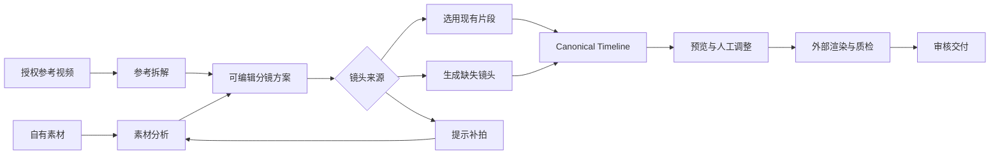

# 自动剪辑与微信小程序综合产品方案

本方案在现有详细设计上增加参考视频拆解、分镜生成、素材匹配与补镜头，以及功能对等的网页与微信小程序工作台。目标是让用户从手机拍摄素材或授权参考视频出发，完成可审阅、可修改、可交付的短视频制作。

已确认范围：小程序面向个人，是可独立完成全部工作的工作台；网页端对用户开放的功能，小程序全部提供。目标用户包括电商商家、个人短视频创作者和代运营等批量生产用户。通过分步操作、上下文工具和渐进展开控制页面复杂度，不通过删减手机功能或强制转到电脑实现简化。当前仓库未发现既有小程序实现；本文是产品与技术设计，不代表功能已开发或已接通真实供应商。

## 参考依据与适用范围

| 参考 | 已取得的依据 | 对本方案的影响 | 尚未确认 |
| --- | --- | --- | --- |
| [飞书参考流程](https://my.feishu.cn/wiki/WN3Aw1ee9iVrjDkNKkHc6jdinCd?from=from_copylink) | 已阅读参考选择、分镜描述、视频生成、后期剪辑和失败调整章节 | 增加参考拆解、结构化分镜、逐镜头生成与后期校准 | 内嵌视频未做逐帧观看；示例中的效果数字没有测评依据 |
| [千谲视频工作台](https://aiqianjue.com/app/video-task) | 已在用户打开的页面查看深色侧栏、左侧输入与参数、右侧结果、智能编导、视频功能菜单及分镜拆分弹窗 | 借鉴参数与结果分区、素材复用、专项工具和局部处理；将分镜衔接到可编辑成片 | 未提交付费生成；无法判断真实质量、速度和费用 |
| [千谲智能混剪](https://aiqianjue.com/app/video-studio/smart-mix) | 已查看配音/口播/无讲解三种模式、素材选择、字幕、速度、清晰度及结果概览 | 将讲解方式作为混剪入口，把成本与输出配置放在提交前确认 | 批量入口需要登录，内部页面未读取；视频剪辑首页部分功能明确为“敬请期待” |
| [现有详细设计](detailed-design.md) | 多租户、素材、任务、时间线、Provider、预算与来源记录 | 保留统一后端，新增业务对象和双端前端 | 真实供应商和生产验收仍需完成 |

参考流程可以归纳为：选择适配参考，拆解主体、场景、风格、镜头和光影，生成镜头，再校准剪辑与声音。产品将这些操作转成可编辑的结构化步骤。流程中的“1 比 1”及相似度数字作为参考意图，不转为本产品的保证；结果按具体维度审核。固定锐化、转场或音量数值也不作为所有素材的默认规则。

页面示意是结合实际观察形成的本项目设计，不是参考产品截图。参考工作台的分镜拆分弹窗标明“纯前端处理”和“仅处理前 15 秒”；本项目为保证网页与小程序能力一致，采用外部分析服务，提供范围选择和超限提示，不静默截断视频。参考产品的参数上限和耗时说明不直接成为本项目承诺。

| 参考产品设计 | 本项目采用方式 | 最终呈现 |
| --- | --- | --- |
| 深色工作区、鲜明主按钮、工具侧栏 | 保留单一强调色和聚焦制作的空间；网页提供深浅外观，小程序默认清晰浅色 | 网页左侧配置/右侧结果；小程序上方预览/下方步骤与工具 |
| 智能编导整理参考、图片、声音和要求 | 编导输出结构化分镜，允许人工确认后再执行 | 可编辑分镜卡片，不只是一段不可追踪的提示词 |
| 独立生图、视频及编辑工具 | 统一工具中心；生成结果回到素材库并可插入当前镜头 | 通用“输入—设置—结果”工具页，两端均可使用 |
| 混剪三种讲解模式 | 统一为现有音频、现有口播、无需讲解；另接文案配音 | 同一剪辑器生成字幕、配音、空镜和时间线 |
| 视频结果区及筛选 | 增加项目、镜头、版本、采用状态与费用归属 | 结果可比较、替换、继续编辑和交付 |
| 批量入口 | 以本项目需求设计，不推测登录后的具体实现 | 网页表格与手机任务卡共用同一批次模型 |

## 产品定位与双主流程

产品统一定位为“有素材自动剪，有参考按分镜制作”。用户无需接触模型接口和任务配置，但可以检查生成依据、选择素材和修改结果。

| 制作方式 | 用户已有内容 | 处理流程 | 最终结果 |
| --- | --- | --- | --- |
| 素材自动成片 | 自己拍摄的视频、图片和可选文案 | 分析素材 → 选模板 → 匹配镜头 → 自动剪辑 → 审阅 | 一条可编辑的成片与时间线 |
| 参考驱动成片 | 授权参考视频与自有产品或人物素材 | 拆参考 → 确认分镜 → 匹配已有素材 → 生成缺失镜头 → 自动剪辑 | 保留选定结构和节奏、使用确认素材的成片 |
| 文案口播成片 | 文案、产品信息和授权声音或人物 | 审校脚本 → 配音或口播 → 匹配空镜 → 自动剪辑 | 带字幕和配音的讲解视频 |
| 批量变体 | 已确认的方案和多个产品或素材组合 | 固定模板 → 限定变化项 → 分批执行 → 汇总审核 | 可比较的多个版本与费用汇总 |

交付按能力分阶段，但每一阶段的用户功能均在两端同步验收；批量是核心需求，基础批量进入首个完整生产版本。口播先复用现有音频或已验收 TTS，数字人等能力在真实服务验证后双端开放。生成并非必经步骤：有合适的真实素材就直接剪辑，只有用户选定的缺口才创建收费生成任务。

| 用户 | 默认创作场景 | 重点实现 | 交付内容 |
| --- | --- | --- | --- |
| 电商商家 | 商品展示、卖点讲解、授权参考制作 | 商品资料卡、外观约束、品牌模板、多商品批量替换 | 商品对应的视频、封面、字幕和版本清单 |
| 个人创作者 | 口播、教程、生活记录、参考策划 | 口播去停顿建议、空镜匹配、字幕修订、系列模板 | 单条成片或系列视频；保留可继续编辑的草稿 |
| 代运营及批量用户 | 多客户、多商品、多开场版本 | 客户项目分组、共享参数、逐项覆盖、批次预算、失败重试与审核 | 按客户和任务归档的成片、审核结果及费用记录 |

默认进入个人空间；客户/品牌是个人空间里的项目分组。团队协作作为可选能力，不要求个人用户先建组织。用户可随时切换场景，不用身份类型限制功能。

## 小程序 网页端与后台分工

| 能力 | 微信小程序 | 网页工作台 | 运营管理端 |
| --- | --- | --- | --- |
| 素材 | 选择/拍摄、上传、标签检索、批量选择与整理 | 文件拖入、批量整理、标签与素材检索 | 存储状态、保留和清理策略 |
| 参考 | 上传、拆解、逐镜头对照、编辑与确认要求 | 并排对比参考和分镜、细化镜头要求 | 分析服务与模板配置 |
| 创建 | 引导式表单、模板、画幅、时长 | 同样支持，提供高级参数 | 能力开放和默认策略 |
| 编辑 | 裁切/分割/排序、叠加、字幕与音轨编辑、转场、画幅；按选中对象展开 | 相同能力，通过多轨时间线、快捷键与并排面板提高效率 | 无需代替用户编辑 |
| AI 工具 | 全部已开放工具，逐项输入、候选对比、局部重做 | 相同能力，可并排比较结果 | Provider 接入、参数和能力配置 |
| 批量任务 | 批量建项、共享设置、逐项覆盖、预算、执行、筛选和失败重试 | 相同能力，表格与快捷操作 | Provider 健康、异常队列、对账 |
| 成片 | 播放、版本比较、审核、下载/保存、分享及交付记录 | 相同能力，批量打包下载 | 删除与撤销处理、来源审计 |
| 协作 | 可选工作区、成员与角色配置、审核意见 | 相同能力，宽屏成员表格 | 租户管理和权限策略 |
| 预算 | 当前额度、任务报价、费用明细、项目/批次预算 | 相同能力，宽屏汇总视图 | 供应商成本和费用调整 |

上述“全部功能”指本项目网页用户工作台功能。平台运维和供应商密钥管理属于服务后台；参考产品与本项目无关的商品详情页等扩展产品线，不因出现在其导航中自动列入本项目范围。新增用户能力必须同时具备网页和小程序入口、可执行操作、结果查看和失败恢复，不能只在手机显示结果。

双端共享项目、素材、分镜版本、时间线版本和任务 ID。用户在小程序创建的项目可以在网页继续编辑；网页修改后，小程序展示新版本并明确提示原预览已过期。原生小程序与网页复用接口契约和状态机，首版不要求复用界面组件。

## 页面设计

### 小程序页面

底部导航为“创作、素材、作品、我的”。“作品”内切换项目、处理中、已完成和批次，首页显示最近草稿与待处理事项。使用清晰浅色内容面、深色文字、单一品牌强调色；错误和成功同时使用文字与图标。沿用参考产品的聚焦工作区和结果继续加工方式，按手机操作重组布局。

| 页面 | 页面内容与布局 | 主要操作 | 关键状态 |
| --- | --- | --- | --- |
| 创作首页 | 顶部个人空间，素材自动剪、参考创作、口播制作、批量制作；下方工具中心与草稿 | 创建项目、继续草稿、按场景选择模板 | 未登录可浏览示例；提交前完成登录 |
| 新建项目 | 一屏一个任务：素材 → 需求 → 方案 → 生成；底部一个主要按钮 | 选文件、选择用途与目标时长 | 草稿自动保存，未上传完成不可继续分析 |
| 参考分析 | 参考播放器、镜头时间条、结构摘要、可继承维度 | 确认节奏、画面结构或风格 | 分析失败保留原文件，允许手工建立分镜 |
| 分镜确认 | 纵向镜头卡片，显示时长、画面意图、素材来源 | 增删镜头、换素材、重排、锁定、改字幕、确认生成缺口 | 缺素材、待确认、待生成、已就绪 |
| 成片编辑 | 上方预览、中间可缩放片段条、下方上下文工具 | 裁切/分割、添加叠加、逐句字幕、音轨、转场和精确时间输入 | 自动保存；未渲染修改与当前预览清楚区分 |
| 批量制作 | 共享配置页 → 项目卡片列表 → 校验和总预算 → 批次详情 | 新建多项、复制、批量赋值、单项覆盖、失败重试 | 部分失败不阻止成功项目继续审核 |
| AI 工具 | 输入素材、少量常用参数、高级设置折叠、结果候选 | 单独处理或应用到当前镜头 | 缺少能力时不产生收费任务 |
| 生成确认 | 镜头数量、生成范围、报价及预算提示 | 确认本次任务 | 费用变化时重新确认；不把重复点击当新订单 |
| 任务详情 | 当前阶段、每个镜头状态、最近更新时间 | 返回继续使用、查看问题、重试可恢复步骤 | 显示“需要你确认”而非所有状态都叫处理中 |
| 成片详情 | 竖屏播放器、版本号、质检摘要、底部操作 | 提交修改、审核、保存到相册、分享 | 成片未通过审核时不显示正式交付 |
| 素材页 | 视频与图片分组、缩略图、上传和分析状态 | 上传、选择、移入项目 | 临时文件失效需要重新选择，不能假装可续传 |
| 我的 | 空间/成员、额度、模板管理、授权资产与使用记录 | 切换空间、管理角色和预算、查看费用 | 充值支付需结合主体和收费方式确定 |

小程序编辑采用单卡片、底部抽屉和全屏编辑。选中片段后可拖动入出点，也可输入精确时间；字幕按句编辑文本、区间、样式和位置；音频按轨配置区间、音量和淡入淡出；叠加元素配置层级、位置和显示时间。轨道可折叠并独立选取，横屏可提高效率但不是必需条件。两端写入同一 TimelineRevision，因此手机也可以独立完成精细调整和正式导出。

跨端继续编辑是可选便利。关联需在登录后验证账号和项目权限，二维码不能包含长期访问令牌。模板编辑同样在手机提供步骤/槽位列表和参数表；如果后续引入可视化工作流，手机用步骤列表、条件与依赖编辑表达相同逻辑，不能只允许在电脑搭建。

### 网页工作台页面

建议保留当前项目的清爽控制台风格，将首页统计退到辅助位置，主要空间用于制作和结果。侧栏固定放“创作、项目、素材、模板、任务、成片”，管理能力按角色显示。

| 区域 | 布局 | 功能 |
| --- | --- | --- |
| 顶部栏 | 项目名、版本、保存状态和工作区 | 告知当前正在编辑什么，避免误操作旧版本 |
| 左侧素材区 | 参考、自有素材、生成候选切换 | 选择输入、检索、拖入或指定镜头来源 |
| 中央工作区 | 分镜卡片与预览播放器 | 编辑画面意图、对比参考、选择生成候选 |
| 右侧参数区 | 当前选中镜头的素材区间、运镜、字幕与声音 | 逐镜头配置，未选镜头时展示项目参数 |
| 底部时间线 | 视频、字幕、音频轨及问题标记 | 裁切、排序、对齐、点击跳转预览 |
| 任务抽屉 | 当前项目任务与阶段 | 查看生成过程，不离开编辑上下文 |

参考模式中增加“原参考”和“当前方案”对照视图。单镜头失败只替换或重做该镜头；全片重新生成必须是明确的新操作。首页模板展示真实案例，系统统计来自真实数据。

### 通用交互规则

所有长任务都有可离开页面的说明；只有正在传输的上传受客户端状态影响，已提交服务端的分析和生成继续运行。断网后保留草稿，恢复时先查询现有任务。费用、版本、来源和授权在需要决策时显示，Provider 错误堆栈留在后台。

按钮文案按业务动作区分：“分析参考”“生成方案”“生成缺失镜头”“生成预览”“确认导出”，不使用一个笼统的“生成”贯穿所有步骤。没有可信进度百分比时显示阶段与更新时间。

## 参考驱动成片的实现设计

### 参考素材接入

首版支持上传视频文件和已登记的授权对象 URI。分享链接先保存为来源备注；只有接入相应平台允许的取回接口时才支持直接解析，不承诺任意平台链接都能下载。参考素材单独标记用途，不默认成为最终成片的可用镜头。

接入后由托管分析服务生成镜头边界、关键帧、语音文本、节奏、景别、运动、主体与场景描述。输出附时间戳、置信度和来源；不确定内容进入确认列表。分析依据与最终生成指令分开存储，参考页面或字幕中的文本不能成为系统指令。

最终呈现为参考播放器、逐镜头条带与“哪些要保留”的选择：时长结构、镜头顺序、画面构图、运镜、视觉风格。音频、品牌和人物使用范围按已有授权记录决定。

### 结构化分镜方案

新增 `StoryboardRevision`，独立于最终 Timeline。每个镜头保存：

| 字段组 | 内容 | 用途 |
| --- | --- | --- |
| 时间 | 参考起止、目标时长、顺序 | 还原被选定的节奏结构 |
| 内容意图 | 主体、动作、场景、核心表达 | 匹配素材或生成镜头 |
| 视觉 | 景别、构图、运镜、光影、风格 | 明确需要控制的条件 |
| 约束 | 产品外观、不可改变细节、品牌素材、人物引用 | 防止重要内容被自由改写 |
| 声音与文字 | 旁白、屏幕文字、音效、音乐位置 | 将画面与音频要求分别处理 |
| 来源 | 原参考时间段、已选素材、生成候选或补拍需求 | 保留可解释的来源关系 |
| 执行 | 状态、报价、Provider 操作 ID、产物 ID | 单镜头恢复与费用归属 |

使用外部多模态服务把分析结果整理成 schema 约束的 JSON。校验时长总和、必需字段、素材引用和未确认事实，最多按有限次数修复结构错误。镜头事实与营销文案由用户确认；产品颜色、文字和材质等来自用户资料，不能从参考片直接当成当前产品事实。

### 素材匹配与生成缺口

每个镜头有三种来源：现有素材、生成候选、用户补拍。先基于素材类型、长度、主体、动作和画幅匹配；展示最适合的少量候选及原因。找不到合适素材时给出补拍建议或生成按钮。

生成提示词由结构化分镜编译，按具体 Provider 支持字段输出。镜头时长与分辨率来自能力目录，不直接套用飞书示例中的模型和参数。允许短片整段生成作为特定能力，但默认逐镜头处理，便于控制成本与局部重做。

复杂动作拆为较小镜头；每个候选保留提示词版本、参考资产、随机种子（如果供应商支持）和费用。同样输入不保证供应商输出完全一致。用户采用候选后才进入时间线编译。

### 自动剪辑与后期校准

已采用镜头编译为 Canonical Timeline。编译器处理源区间、目标时长、画幅适配、字幕、转场和音轨；不支持的功能提前拒绝。色彩调整、裁切、锐化、音频对齐由外部媒体编辑服务执行，不能把后期锐化当成修复结构性变形的方法；产品变形的镜头回到候选替换或重新生成。

用户对照参考检查结构、节奏、主体、运镜、色彩和音画同步，分别确认。系统不显示没有测评依据的“还原度 90%”。图像相似指标若后续引入，应作为参考而非验收的唯一分数。

## 自动剪辑能力的加强

现有评分器继续用于素材自动成片，但新增“镜头需求”作为匹配对象。参考模式由分镜提供镜头需求，模板模式由槽位提供需求，两者最终使用同一匹配器与编译器。

| 子能力 | 实现方式 | 用户能得到什么 |
| --- | --- | --- |
| 语义匹配 | 用托管分析输出的标签和描述对齐镜头需求，低置信度候选需确认 | 更接近文案或分镜意图的空镜 |
| 时长分配 | 硬约束求可用区间，再按模板与参考节奏分配 | 不越界、不暗中拉长镜头 |
| 镜头多样性 | 同源去重、相邻镜头约束和主体连续性检查 | 降低重复感，同时保持主题一致 |
| 人工锁定 | 镜头卡片保存锁定与采用候选 | 重做其他镜头时保留满意部分 |
| 字幕修订 | ASR 与文本修改分版本保存，再生成字幕轨 | 自动字幕可以逐句修正 |
| 音乐与配音 | 明确音轨区间、响度与淡入淡出，由外部服务混音 | 音画同步且声音可控 |
| 批量变体 | 固定方案，仅改变允许的素材、开场、字幕或配音 | 多条有明确区别的版本，不无上限组合爆炸 |

## 批量生产与三类用户的完整闭环

批量不是循环点击单条生成。新增批次配置快照，每个子项固定输入素材、模板版本、允许变化的字段、输出规格和预算；预检后才创建子任务。组合数量在提交前明确显示，不能把多个可选字段展开成用户未确认的大量组合。

| 子内容 | 实现方法 | 预期效果 | 最终呈现 |
| --- | --- | --- | --- |
| 商品/客户资料 | 项目关联商品名、确认的卖点、品牌资产和客户分组；模板引用字段 | 复用资料并减少跨客户混用 | 商品资料卡、客户项目列表 |
| 建立批次 | 两端支持新增/复制任务、批量选素材、粘贴结构化清单；文件导入作为附加入口 | 手机不依赖电脑准备表格也能批量制作 | 网页表格；手机可折叠任务卡 |
| 共用与覆盖 | 共用模板、画幅、配音及字幕样式；每项只保存覆盖字段 | 修改一组设置即可作用于未执行项 | “应用到所选”及单项差异提示 |
| 校验与报价 | 检查素材可用性、必要字段、时长和能力；逐项报价并冻结批准的配置 | 提交前发现缺口，确定数量与预算上限 | 可执行/待补充列表，总额及逐项估价 |
| 执行与重试 | 批次聚合独立 Job；限流、并发额度、单项幂等；区分恢复原操作和重新付费生成 | 局部失败可恢复，不重复提交成功项目 | 成功/处理中/失败筛选与失败原因 |
| 取消与费用 | 未提交外部服务的项可取消；已提交项按供应商能力尝试取消并继续对账 | 取消不误报退款或免费 | 已取消、取消请求中、已产生费用等明确状态 |
| 批量审核 | 逐项通过或退回，记录意见；可选中多项确认，但保留对应版本 | 审核与制作分离，支持客户反馈 | 手机逐条滑动审阅；网页网格审阅 |
| 交付与归档 | 产物按批次/客户归档，服务端生成清单与可选打包文件 | 成片可追溯、可批量领取 | 两端均能查看/领取；手机逐条保存视频，打包文件按设备支持保存或分享 |

默认只显示“新增项目、共用设置、开始批次”三个核心动作，高级筛选、字段映射和并发管理逐层展开。基础批量也要具备预算、部分成功、单项重试和审核，不能以仅复制模板代替批量闭环。

## AI 工具与编辑能力的统一呈现

工具中心承接已有详细设计的 AI 模块。参考产品中已看到的菜单项只是参考依据，不代表本项目已经接通。采用相同的工具注册结构：输入 schema、参数 schema、能力版本、报价、输出类型和可继续加工动作；网页与小程序读取同一目录，已验收的工具在两端同步开放。

| 能力组 | 实现方法 | 能达到的效果与限制 | 最终呈现 |
| --- | --- | --- | --- |
| 脚本与智能编导 | 外部文本/多模态服务输出结构化脚本与分镜，校验字段和总时长 | 把创作意图转成可编辑方案；产品事实仍需用户确认 | 脚本编辑页、分镜卡片与参考对照 |
| 图像与视频生成 | 输入授权参考和分镜约束，调用已验收的生成 Provider | 补足选定镜头或封面；主体一致性需要审核，不承诺完全复现 | 候选网格、逐项比较、采用或重做 |
| 配音与声音 | TTS 或授权声音能力，记录文本、语速、声音版本与音频时长 | 文案变配音并驱动字幕和镜头长度 | 试听、发音修正、配音轨编辑 |
| 数字人口播 | 授权人物/Avatar 与音频绑定，外部服务生成并检查同步 | 生成讲解片段，保留来源；质量未通过时替换或重做 | 口播结果、字幕及插入时间线入口 |
| 视频处理 | 通过已验收服务提供裁切、画幅适配、清晰度处理等 | 输出符合规格的素材；不能承诺还原原片不存在的细节 | 工具前后对比和新素材版本 |
| 翻译与字幕 | ASR、用户修订、翻译、时间对齐，必要时重配音 | 生成语言版本；专有名词、排版与音画同步需检查 | 双语逐句编辑、语言版本列表 |
| 商品/主体替换等扩展 | 参考产品菜单中的替换、舞蹈复刻、字幕擦除单独做供应商验证 | 可列入后续工具目录；不把尚未验证的效果纳入首版承诺 | 与其他工具相同的输入/设置/候选页 |

所有工具产物进入同一素材库，保留来源、操作和费用，可插入当前镜头或另建项目。不会出现生成工具能产出文件、编辑器却无法继续使用的断点。具体九类 AI 模块及授权要求以[详细设计](detailed-design.md)为准。

## 微信小程序接入方案

### 登录与跨端身份

拟采用微信登录凭证由服务端兑换身份，再映射为平台 User、Membership 和 Tenant，签发本平台短期会话。不能把 OpenID 直接当作租户权限或长期 API 密钥。多端账号关联需要明确绑定流程，不能假定所有场景都能获得同一 UnionID。

小程序 API 入口验证本平台会话，并转换为现有 trusted proxy 可接受的内部身份；核心业务接口继续复用。AppSecret、平台密钥和 session_key 均不下发客户端。该流程的具体微信接口和账号条件需要在实现时以可访问的官方文档及账号控制台复核。

### 上传与保存

使用媒体选择或拍摄能力取得本地文件，由服务端签发短期、限定对象路径和文件大小的上传凭据，小程序直接上传托管存储，再走现有完成证明。腾讯云官方提供使用 `wx.chooseMedia` 配合小程序上传接口直传 COS 的实践，可作为实现参考，不意味着项目必须选定 COS。[官方直传实践](https://cloud.tencent.com/document/product/436/34929)

小程序网络域名需要提前配置，API、上传和下载地址统一使用受控 HTTPS 域名。生成产物不能直接把任意供应商地址交给小程序下载；由存储网关归档到已配置的访问域名并签发短期链接。[微信官方服务器配置说明](https://pay.wechatpay.cn/doc/v3/partner/4012089542)

将浏览器的 presigned PUT 路径直接复制到小程序并不足够；存储网关需明确返回上传方式及表单字段，适配实际采用的小程序上传 API。大文件分片与恢复按所选存储 SDK 做真机验证。客户端退出后，本地临时文件可能不可恢复，界面应允许重新选取同一文件，不能承诺无条件后台持续上传。

成片下载到手机后再保存到相册，权限拒绝、空间不足和链接过期都有恢复入口。相册保存的具体接口、格式及权限应在目标基础库和真机上验证；腾讯云官方小程序实践展示了保存本地视频文件的调用方式。[官方小程序实践](https://cloud.tencent.com/document/practice/616/86945)

### 长任务 通知与分享

任务提交后由服务端执行。小程序回到前台时刷新任务，页面内采用退避轮询；可选完成提醒在用户主动开启且账号具备适用消息模板后发送。拒绝提醒不会影响任务完成，也不承诺退出后一定收到通知。微信通知接口和模板资格列入上线前复核项。

“分享作品”设计为分享受权限控制的作品页面或短期授权入口；“保存到相册”是独立动作。第一版不承诺自动发布朋友圈、视频号或其他平台。需要发布接口时独立确认平台接入资格和授权。

### 工程与发布范围

首版建议建立独立 `miniprogram/` 工程，采用微信原生页面与 TypeScript，优先确保视频、上传和系统交互的真机可用性。这是当前项目的工程提案，若已有 uni-app/Taro 等团队技术栈则按既有约定调整。网页端保留现有静态实现并按模块拆分，不在同一阶段强制重写。

在 Android 和 iOS 真机分别覆盖：登录过期、选片、上传中切后台、网络切换、任务返回、播放、保存权限拒绝和大文件处理。最低基础库、文件上限、消息模板与上线类目等以实际账号与验证结果确定，方案不预设未经核验的固定额度。

## 数据与接口增量

| 新增对象 | 关联现有对象 | 关键内容 |
| --- | --- | --- |
| ReferenceAnalysis | Asset、Job | 镜头边界、描述、节奏与分析版本 |
| StoryboardRevision | Project、Template、ReferenceAnalysis | 可编辑分镜、确认状态与约束 |
| ShotCandidate | StoryboardRevision、Asset、Artifact | 素材区间或生成候选，采用状态 |
| GenerationBatch | Project、Job | 镜头子任务、预算上限、批次与变体 |
| UserIdentity | Tenant、成员关系 | 微信账号映射、跨端绑定与平台会话 |
| NotificationPreference | UserIdentity、Job | 用户提醒意图、模板和发送结果 |

建议新增业务接口为 `POST /references/{id}/analyze`、`POST /storyboards`、`PATCH /storyboards/{id}/revisions/{revision}`、`POST /storyboards/{id}/generate-missing` 与 `POST /storyboards/{id}/compile`。它们均为待实现命名，底层复用现有 Job，不再建立第二套任务系统。

小程序侧新增登录会话与账号绑定接口；上传、素材、任务、Artifact 和预算继续共用。任务状态必须由服务器决定，客户端只能发起业务动作。版本更新采用条件校验，两个端同时编辑时不静默覆盖。

生成批次采用父任务聚合子任务：一个镜头失败不取消已成功镜头，重试只对选定失败镜头执行；整批重新生成建立新报价和操作。使用已有详细设计中的统一完成事务、事件去重和结果唯一键保证轮询与回调一致。

## 三层交付与验收

| 阶段 | 交付范围 | 验收样例 |
| --- | --- | --- |
| 第一层 双端生产闭环 | 统一身份、上传、模板、自动剪辑、完整基础编辑、预览/审核/导出、预算、基础批量；两端同步 | 独立用手机上传 5 段素材制作 30 秒视频，修改裁切/字幕/音量后导出；独立创建 10 项批次，模拟部分失败后仅恢复失败项 |
| 第二层 参考与内容生成 | 参考拆解、分镜编辑、素材匹配、生成缺口、局部重做、文案配音；两端同步 | 仅用手机完成授权参考拆解到最终交付；修改一个镜头不重做其他镜头；网页可打开相同版本 |
| 第三层 规模与扩展能力 | 客户/商品资料、品牌模板、批量变体、成员协作、数字人和其他已验收 AI 工具；两端同步 | 在手机完成多客户批次、角色配置和审核；复用模板生产明确数量的变体，逐项记录来源与费用 |

第一层开展前先修复现有并发完成事务、前后端入口、上传证明与生产配置问题。后续能力不能绕过这项基础工作。

参考驱动验收逐项记录结构、时长、主体外观、运镜、字幕、声音和可交付性，失败能归因到具体镜头。小程序验收除上传和状态恢复、草稿不丢、可播放与可保存外，必须逐项覆盖网页已开放功能：新建、编辑、执行、局部恢复、查看结果和交付。每条核心场景都做一次“仅手机完成”，跨端演示不能替代手机独立验收。

建议固定电商、个人口播、代运营批量三组样本，每组包含正常输入与异常输入；记录剪辑准确性、素材重复率、字幕错误、人工修改次数、端到端耗时与实际费用。先形成基线再确定服务指标，不从公开营销描述推导质量、耗时或成本。

## 已确认范围与实施前待补信息

已确认小程序独立完成全部用户工作、双端功能对等、界面尽量简单，并同时服务商家、个人创作者及批量用户；已读取两个参考站点的可访问内容。批量产品内部页仍受登录限制，方案中的批量交互是根据项目需求设计。

以下信息影响实施和接入，不妨碍当前产品方案成立：

1. 小程序 AppID、主体、既有设计稿和团队技术栈：本版默认新建原生 TypeScript 工程。
2. 收费方式和充值支付是否首发：当前明确额度、报价和费用记录；实际支付按目标主体、终端和支付规则确定接入方式，不用未经核验的外链方案替代。
3. 首批真实 Provider 和可接受的单条成本：决定能力验收与报价，不改变双端业务流程。
4. 是否需要直接发布到第三方平台：当前完整交付范围是审核、导出、相册保存、受控分享；自动发布作为独立接入需求。

## 与现有方案的关系

本方案确定用户流程、双端功能对等、批量生产和参考驱动能力。[详细设计与交付方案](detailed-design.md)继续定义核心控制面、可靠性和验收原则；涉及小程序定位和双端范围时，以本方案最新确认内容为准。后续将分镜、身份、编辑器与批次能力拆成开发任务，并更新 API 契约和工作台文档。本次仅交付设计与交互示意，没有将示意页面接入生产服务。

具体执行拆分见[开发任务与推进路线](development-roadmap.md)，包括任务优先级、依赖、当前基础、验收条件和外部资源；完整目标文本见[项目 Goal](project-goal.md)。
